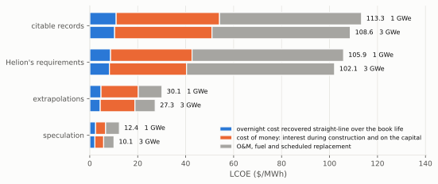
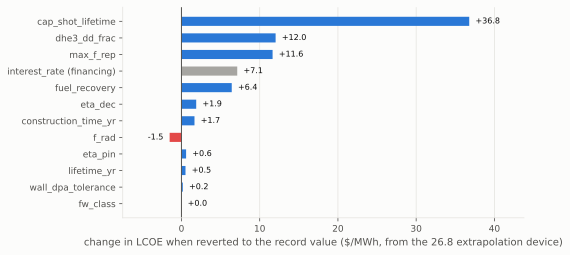
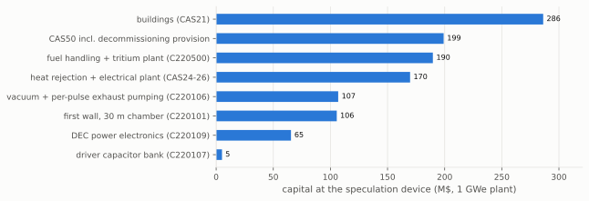
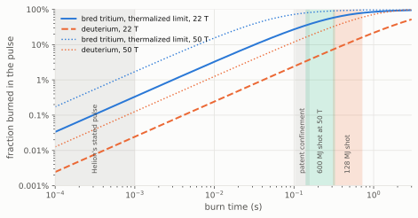
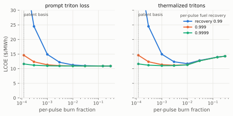

# The techno-economic floor of a Helion-class pulsed inductive fusion power plant

*Tal Rubin, Astera Institute*

This work asks how cheap fusion electricity can get if direct energy
conversion is the key technology for harnessing fusion energy. It is one
of six studies, each taking such a thesis to its physically coherent
limit and asking how low the levelized cost of electricity (LCOE) can be
driven.

Direct energy conversion escapes the working-temperature limit of a
conventional working fluid and replaces the turbine island. The fuel
best suited to it is deuterium-helium-3 (D-He3), whose fusion energy is
carried largely by charged particles, and one of the best mechanisms is
inductive recovery: a magnetic field compresses the plasma, which then
expands against that field as the gas in an engine expands against a
piston. That is what Helion Energy is building, and it has stated a
long-run ambition of electricity at 1 cent/kWh ($10/MWh), the figure the
1cFE residency at Astera is set on investigating. This work takes
Helion's published design and results as its starting point.

**The findings, in brief.** Four devices share the architecture and
differ only in the evidence grade of what they are granted: citable
records alone, Helion's own requirements at face value, labeled
extrapolations, and speculation. They read 115.3, 105.9, 37.7 and 13.0
$/MWh at 1 GWe, and the speculation park reads 11.0 $/MWh at 3 GWe, so
no stack crosses the target: the cheapest coherent machine misses it by
1.0 $/MWh, on a 3% real cost of capital worth 4.4 (15.4 at 7%). Every
number grants Helion's shot, 128 MJ from a 50 MJ bank, which no record
supports and which needs a burn of 0.3 to 0.7 s against Helion's own
stated pulse of hundreds of microseconds to milliseconds; on citable
records alone the machine makes no net power. The burn must also fit
between shots, and that rule sets the fuel mix at every grade: the
deuterium-rich mix that breeds more He-3 than it burns is power-sparse,
its burn overruns the pulse period at the repetition rate a cheap plant
needs, and the design search runs each grade as deuterium-rich as its
period allows, 80% of events D-D at the records grade, Helion's own mix
(49%) at extrapolations and the He-3-rich preset (13%) at speculation.
The deuterium-rich designs the rule excludes would read 112.1, 26.8 and
10.6 $/MWh, and 8.4 as a 3 GWe park. At the extrapolation device the
largest levers are the fourth nine of per-pulse fuel recovery and the
capacitor cycle life, each worth about 35 $/MWh, three times the
repetition rate. The fuel cycle, not the driver, is the load-bearing
subsystem either way: the cheap devices buy He-3 at prices no market
supports, and the deuterium-rich designs, like Helion's own device and
the records device, hold a tritium store of two thirds of a tonne to
two tonnes while it decays. The data that would move the ladder are all
Polaris data, first among them the yield of a burning shot at its
measured burn time.

The costing uses the `1costingfe` bottom-up cost model [1]
([code](https://github.com/1cFE/1costingfe),
[documentation](https://files.1cf.energy/1costingfe_paper.pdf)). Section
2 describes the device, Section 3 the four devices and their
constraints, Section 4 their cost, Section 5 the He-3 fuel cycle, and
Section 6 the bound on the yield of a shot and the recovery physics.

## 2. Machine basis

Two field-reversed configuration (FRC) plasmoids are formed in opposed
formation sections, merged in a central compression section, where the
collision converts their directed kinetic energy into ion heat, and
magnetically compressed to burn conditions [2, 3]. The pulsed-power
driver is the only heater. After the burn the plasma expands against the
field, returning driver energy and charged fusion energy to the coil
circuit as work; radiated power, undirected charged power, and neutrons
are not converted.

The design-basis shot is built from three public numbers: the driver
delivers 50 MJ per pulse (the Polaris capacitor bank), the plant fires
at 1 Hz, and Orion, the first plant, is to supply Microsoft at least 50
MWe [2], taken here as one module, the 50 MWe unit Helion's CEO
describes coming off a gigafactory line, one a day, on a truck [4]. The
yield per shot is whatever turns that shot into 50 MWe at 1 Hz at the
burn point Helion's patent discloses (Section 5): 128.1 MJ, a gain of
2.56 over the delivered driver energy, a consistency figure rather than
a disclosed measurement. The chamber radius is 0.61 m, the smallest at
which a 10 m cylinder wall survives the shot under the tungsten flash
bound of 1.5 MJ/m^2 per pulse; the Helion device at 1 GWe is 20 modules.
The public record as of September 2026 is D-T fusion on Polaris with no
published yield or recovered electricity, from a company that has
withdrawn "net electricity" from its own goals [2, 5].

Helion does not report the data a costing needs, and this work fills
each gap by grading it (Section 3): the yield of a burning pulse and its
burn time; the energy recovered with plasma present, measured on seven
prototypes per the FAQ with no figure given; the reactor-point density
and field; the per-pulse separation rate and per-pass fuel recovery; and
the duty cycle of multi-hertz operation. The capacitor cost at cycle
life, the other datum the ladder rests on, is a supplier's, not
Helion's.

## 3. Method

***Notation.** Model parameters keep their configuration-file names.
dd_frac is the D-D share of primary fusion events by count (Helion's mix
0.49, the D-rich mix 0.85); dhe3_f_T the fraction of bred tritium that
burns in-pulse; eta_dec and f_pdv the circuit efficiency of inductive
recovery and the fraction of the plasma's expansion work that reaches
the coils, their product the composite recovery; chi the plasma-thermal
share of the delivered driver energy and x_s the separatrix-to-coil
radius ratio.*

**Evidence ladder.** Held at every grade: constant-dollar framing and
EPCM indirects at 20% of direct cost [6], which the model scales with
the build, so the effective fraction is 16.7% at a 5-year build, 10.8%
at 3.25 years and 8.3% at 2.5 years. Construction time steps 5 years at
the design basis and records grades (the serial Hualong One builds,
about 60 months [7]), 3.25 at extrapolations (the Kashiwazaki-Kariwa
ABWR pair, 37 and 39 months to fuel load [8]) and 2.5 at speculation (a
combined-cycle gas turbine timeline). The cost of capital steps 7% real
at the design basis and records grades (the IEA/NEA central case [9]),
5% at extrapolations, 3% at speculation (the IEA/NEA low case [9]); it
is the one financing entry, kept separate in Figure 1 and the at-7%
column. Book life is 60 years through the records grade, a
series-consistency entry rather than a record (the other candidate
corridor studies hold 60 at their records rung; 60 is the standard
first-renewal licence term, above the about 57 years of the
longest-running units and below the 80-year subsequent renewals
thirteen US plants hold [24], and above the fusion literature's 30-40
year cluster [10]), and 80 years above it (the US DOE hydropower
lifespan [11]). Availability is
derived from 0.98 outside planned outages, less a routine outage every
two years [12], a capacitor-bank swap at the bank's shot life, and a
wall-and-coil changeout at the displacement-damage tolerance (20 dpa
through the records grade, 50 above it): 0.895 at the records device,
0.932 at speculation.

Helion makes two unrecorded claims. The records device holds one at its
evidence-supported value, per-pulse fuel recovery 0.999 (the
fuel-retention analogy to JET [13]); the other, the shot, has no
evidence-supported value above zero, so on evidence alone the records
device makes no net power, and it is priced at Helion's shot only so
that a machine exists to cost. The Helion device grants Helion's 0.9999
(four nines) and the shot; the extrapolation and speculation stacks keep
that grant and add the labeled entries listed in Section 4, the largest
being capacitor life 1e9 shots (Pacific Fusion's derating target [14]).
Every entry carries a source and grade in the evidence ledger
(`docs/ledger.md`); no extrapolation entry is a measured record.

**Coherence constraints.** Eight couplings are applied to every quoted
point: six enforced by the scripts as checks, the seventh (derived in
Section 6) applied by construction, every point carrying the burn time
its shot implies, and the eighth enforced on that burn time:

1. The radiated fraction follows the burn mix through a bremsstrahlung
   floor (f_rad = 0.28 at dd_frac 0.85, not Helion's stated 0.05).
2. Recovery is capped as the composite eta_dec x f_pdv (0.80 through
   the extrapolation grade, 0.90 at speculation), because the only
   published figure speaks to the product.
3. The wall must survive its steady flux within the purchased class (a
   panel wall of the ITER first-wall kind at about 2 MW/m^2, or a
   divertor-class monoblock at 10 MW/m^2) and its per-shot flash under
   the tungsten millisecond-melt bound.
4. A mix with dd_frac at or above Helion's 0.49 carries its tritium
   plant: 50 M$ fixed plus 0.657 M$ per MW of plant neutron power.
5. dhe3_f_T is floored by the burnup closure of Section 5.2 (floor
   0.002 at the patent basis; the design's zero passes).
6. f_pdv is capped per point at the adiabatic-stroke bound
   1 - (V_i/V_f)^(2/3), V_i the compressed flux volume at 22 T and V_f
   the chamber (Section 6).
7. The shot yield is bounded by the plasma energy and the burn time,
   gain <= chi x burn time / breakeven time, the breakeven time taken
   at the mix the point actually burns, so every quoted point carries
   the burn time its shot implies, and the shot takes each device's
   grade rather than serving as a shared basis.
8. A shot's implied burn must fit inside the pulse period, burn time x
   repetition rate <= 1, because one burn section holds one plasmoid
   and the next shot cannot fire while the last is still burning; the
   limit of 1.0 is the hard bound, with nothing reserved for exhaust,
   refill and recharge. The rule caps the fusion power of one burn
   section at chi E_del / breakeven time: 1.76 GW at the He-3-rich mix,
   401 MW at Helion's, 126 MW at the deuterium-rich mix with three
   nines of recovery. It is evaluated at the reference x_s 0.7 (Section
   6).

Each device except Helion's own configuration is the argmin of a scan
over shot yield (free only at speculation), chamber length and radius,
wall class, and burn mix (seven mixes from the He-3-rich preset to the
deuterium-rich end), discarding designs that violate a constraint.
Reconciliation brackets each minimum with the model gaps it cannot price
internally (switch duty, the tritium-plant band, driver thermalization)
and its conservatisms (no thermal bottoming).

## 4. Results: the four devices and what carries the floor

| device | 1 GWe | 3 GWe | at 7% real cost of capital, 1 GWe |
|---|---|---|---|
| citable records | 115.3 | 111.0 | 115.3 |
| Helion's requirements | 105.9 | 102.1 | 105.9 |
| extrapolations | 37.7 | 34.9 | 44.3 |
| speculation | 13.0 | 11.0 | 18.2 |

LCOE in $/MWh. The at-7% column reprices each device at a 7% real cost
of capital with everything else unchanged; the gap is what the grade's
cheaper money is worth, 6.6 $/MWh at extrapolations and 5.2 at
speculation. The stacks:

- **citable records**: fuel recovery 0.999, 7% real cost of capital,
  60-year life, 5-year build, Helion's shot granted; optimum: 24
  panel-wall modules of 10 m x 0.75 m at 1 Hz at dd_frac 0.80 with its
  tritium plant, the richest deuterium mix whose burn fits the 1 Hz
  period
- **Helion's requirements**: Helion's configuration (20 modules in the
  smallest chamber that survives the shot, Helion's mix with its tritium
  plant, 7% real cost of capital, 60-year life, 5-year build) granted
  the shot and fuel recovery 0.9999
- **extrapolations**: records + capacitor life 1e9, a 3 Hz ceiling, a
  purchasable divertor-class wall, fuel recovery 0.9999, 5% real cost of
  capital, 80-year life, 3.25-year build; optimum: six 15 m x 0.75 m
  panel-wall modules at 2.7 Hz at Helion's own mix with its tritium
  plant (the 3 GWe park of 17 modules takes the 10 m x 1.5 m chamber,
  since the 15 m x 0.75 m one trips the panel wall's steady flux once
  the count snaps)
- **speculation**: extrapolations + 10 Hz, the composite at its theory
  optimum 0.90, capacitors at 0.1 $/J and 1e10 shots, He-3 at 0.5 M$/kg,
  3% real cost of capital, 2.5-year build; optimum: 200-750 MJ per shot
  from the same 50 MJ driver (500 MJ carried, a 1 to 3 s burn at the
  patent point and 0.28 s at its own mix), a single module in a 15 m x
  1.5 m chamber at the He-3-rich preset mix with no tritium plant; the
  3 GWe park is three 200 MJ modules at 6.8 Hz

Coil cost grows as the cube root of chamber length while the recoverable
fraction grows with radius squared, so the minima are short, fat
chambers. Reconciliation brackets the extrapolation device within
32.1-41.8 $/MWh and the speculation device within 12.6-13.5 $/MWh at 1
GWe. The burn mix is set by constraint 8: the deuterium-rich mix
(dd_frac 0.85) breeds more He-3 than it burns but is power-sparse, its
breakeven time 138 ms at four nines of recovery and 207 at three
against 65 ms at Helion's mix and 15 at the He-3-rich one, so its burn
does not fit between shots at any grade (the deuterium-rich designs
read 112.1, 26.8 and 10.6 $/MWh at duties of 1.00, 1.87 and 9.39). The
search runs each grade as deuterium-rich as its period allows, and the
constraint costs 3.2, 10.9 and 2.4 $/MWh against those designs; what
the cheap machine buys instead of breeding is He-3, a 15.2 $/MWh fuel
line at the extrapolation device and 4.5 at speculation.

The records device sits 9.4 $/MWh above Helion's requirements on one
claim, Helion's fourth nine of fuel recovery. At Helion's own mix, which
breeds less He-3 than it burns and keeps buying, that claim is worth
about 47 $/MWh (Section 5.2 derives the multiplier); the records device
escapes most of it by running as deuterium-rich as its 1 Hz period
allows. Both devices are dominated by scheduled replacement of the
recovery chain, about 17 times over a 60-year life at the 1e8-shot
record.

*Figure 1: The four devices at 1 and 3 GWe, each bar split into
overnight cost over the book life (blue), the cost of money (orange),
and O&M, fuel and replacement (grey).*

The extrapolation device changes what is bought, each entry a labeled
step beyond a record with a physical argument behind it; the speculation
device changes prices and ceilings, none with a mechanism behind it.
One-at-a-time reversion from the extrapolation device ranks the levers:

| parameter reverted | LCOE ($/MWh) | delta ($/MWh) |
|---|---|---|
| fuel_recovery -> 0.999 (JET-analog; the reverted point overruns its period, duty 1.03) | 73.0 | +35.2 |
| cap_shot_lifetime -> 1e8 | 71.6 | +33.8 |
| max_f_rep -> 1 Hz | 47.9 | +10.2 |
| interest_rate -> 0.07 (financing) | 44.3 | +6.6 |
| eta_dec -> 0.85 (trips the panel wall's steady flux) | 40.0 | +2.2 |
| construction_time_yr -> 5 yr | 39.2 | +1.4 |
| f_rad -> 0.23 (Helion's own, above the 0.20 floor; trips the wall's steady flux) | 38.6 | +0.8 |
| eta_pin -> 0.95 (driver wall-plug) | 38.6 | +0.8 |
| lifetime_yr -> 60 | 38.3 | +0.6 |
| wall_dpa_tolerance -> 20 | 37.8 | +0.1 |

The fourth nine of fuel recovery and the capacitor cycle life dominate,
each worth about 35 $/MWh; the rep rate follows at a third of their
weight; then the cost of capital, the inductive efficiency, the
3.25-year build and the 80-year book life. The fourth nine is worth 35
here because the extrapolation device buys most of its He-3 and the loop
wastes 71% of it at three nines; the mix is not a lever, since the
device already burns Helion's mix. f_pdv and the shot are absent: the
extrapolation stack leaves f_pdv at 0.80 under a cap that does not bind,
and the shot's record value is no plant.

*Figure 2: One-at-a-time reversion of each extrapolation entry to its
record value. The grey bar is the financing entry; the reversions that
leave the coherent set are marked in the table.*

At the speculation device the capacitor-driver narrative is spent: the
bank is 5 M$ of a 363 M$ reactor account, and buildings (254 M$),
decommissioning and supplementary capital (184 M$), and heat rejection
and electrical plant (154 M$) each outweigh the 70 M$ of conversion
electronics and 11 M$ of coils; the He-3 the device buys, 76 kg/yr at
0.5 M$/kg, is 4.5 $/MWh of its 13.0, and O&M 4.1.

*Figure 3: Capital accounts carrying the speculation device. The driver
bank is the smallest bar; site infrastructure and the fuel cycle
dominate.*

## 5. The He-3 fuel cycle is the load-bearing subsystem

The fuel cycle is the one in Helion's patent [15], whose operating table
also fixes the burn point: He3/D = 0.158 at 70 keV and 22 T, radiating
23% of its fusion power as bremsstrahlung and releasing 6% as neutrons.
The D-D reactions close the cycle: half produce a He-3 atom directly
(the prompt branch); the other half a triton (the tritium branch),
pumped out with the exhaust after the pulse, separated, and stored until
it decays into He-3 (12.3 yr half-life). Almost none of the tritium
burns before it is removed (dhe3_f_T = 0 in the basis). The plant has no
lithium; its tritium plant is an exhaust-processing and storage plant.

### 5.1 The He-3 balance and the observed market

The tritium branch, half of the D-D events, produces 0.5 dd_frac tritium
nuclei per primary event (0.40 at the records device, 0.24 at Helion's
mix, 0.07 at the He-3-rich speculation device), and each decays to He-3
on the 17.8 yr mean life of that 12.3 yr half-life. That He-3 is fuel
for the reactor: it replaces purchased He-3 atom for atom, and from an
empty store the replacement builds as 1 - e^(-t/17.8 yr), reaching its
full value against the 1 - dd_frac the plant burns only at equilibrium.
This work levelizes the credit over the book life at the grade's rate;
the prompt bred He-3 counts as extra burns, not as supply. A plant that
breeds more than it burns buys He-3 only until the store covers its
need, about eight years, so the records device's levelized purchase is
30% of the perpetual one; a mix that breeds less keeps buying, 79% at
Helion's device, 75% at the extrapolation device and 95% at speculation.
Bought in perpetuity at the ledger price, He-3 would cost the four
devices 37.4, 5.2, 5.0 and 0.2 $/MWh more; free, it would save them
16.2, 19.7, 15.1 and 4.4, and re-run at zero price the extrapolation
device leaves Helion's mix for the He-3-rich one (dd_frac 0.13) with no
tritium plant at 20.3 $/MWh, and the speculation device reads 8.5.

The price matters because no cheap He-3 exists. The DOE Isotope
Program's 2011 allocation was 600 $/L to federal and 1,000 $/L to
commercial users [16], 4.5 and 7.4 M$/kg; the 2024-2026 transactions
(Edelgas spot, the Interlune agreements, TAE's lunar option [17]) sit at
19-22 M$/kg on gram-to-kilogram volumes. The 2 M$/kg this study charges
sits below both, and the speculation entry, 0.5 M$/kg, nine times below
the 2011 allocation; at that allocation the extrapolation device reads
55.7 $/MWh, at the commercial spot 169.5. A kilogram of He-3 bought by
the speculation device becomes 1.4 M$ of electricity at its own price
but sells for 19-22 M$ today, so an early breeding plant earns more
selling He-3 than burning it.

The store that breeding implies is large. Every module breeds tritium
at half its D-D rate: Helion's own device 38 kg/yr from 104 MW of plant
neutron power, the records device 122 kg/yr from 340 MW, the
extrapolation device 31 kg/yr from 84 MW, the deuterium-rich designs 56
to 78 kg/yr. Store-for-decay fixes the equilibrium inventory at
production rate times the 17.8 yr mean life: 0.67 tonnes at Helion's
device, 2.2 at the records device, 0.55 at the extrapolation device,
1.0 to 1.4 at the deuterium-rich designs; a tonne is 1e10 Ci, about 320
kW of decay heat, 250x ITER's site authorization and 35x the world's
civilian stock. The inventory is intrinsic to breeding at this scale; a
central fuel facility relocates it but cannot shrink it, and only the
He-3-rich speculation device escapes it (4.6 kg/yr, 80 kg stored) by
buying its He-3. This is why the ledger refuses the "near-zero
licensing" claim, holds O&M at its baseline, and treats the
tritium-plant allowance as more likely low than high.

### 5.2 Fuel recovery and the burnup closure

Helion's cycle depends on pumping the bred tritium out of the exhaust
before it burns, so whether the shot and the fuel plan are compatible is
a question about pulse length, not a modeling choice. The
store-and-decay idealization (dhe3_f_T = 0) is therefore a claim about
pulse kinetics: a triton born mid-pulse sits in a deuterium-rich plasma
at fusion temperature for the rest of the burn, and D-T reactivity is
27-87x D-D at 70-20 keV [18]. The per-pulse deuterium burnup pins the
integrated exposure x_DD = -ln(1 - f_D) = n_D <sigma v>_DD tau, and
averaging over triton births gives the thermalized-limit in-pulse
tritium burn

    f_T = 1 - (1 - e^-x)/x,  x = (sv_DT / sv_DD) x_DD,

whose only physics input is the reactivity ratio. Prompt orbit loss from
the plasmoid, whose separatrix sits only a few ion gyroradii from the
field null, is the one mechanism that can hold the burn below this
floor. This is constraint 5.

The basis is the patent's burn point, n_D = 0.75e22 m^-3 at 70 keV, and
Helion's stated pulse, not the patent's confinement time (0.10 to 0.16
s, three to four orders beyond any demonstrated FRC confinement). Over a
sub-millisecond pulse the burnup is 1.2-2.5e-4 and the in-pulse tritium
burn 0.2-0.3%, so dhe3_f_T = 0 passes with two orders of margin. Figure
4 draws the closure against burn time: at the 0.3 to 0.7 s the
design-basis shot needs under constraint 7, a thermalized triton burns
58 to 80% before removal (88 to 95% at the speculation shot's 1 to 3 s),
so the store-and-decay cycle and the granted shot are coherent together
only under prompt triton loss, the branch the burnup axis of Figure 5
prices at high burnup.

*Figure 4: The burnup closure against burn time at the patent point:
per-pulse deuterium burnup (dashed) and the thermalized-limit in-pulse
burn of a bred triton (solid), with Helion's stated pulse, the patent's
confinement time, and the burns the design-basis and speculation shots
need under constraint 7 marked. The store-and-decay basis holds at the
stated pulse, not at the burn the granted shot needs.*

Fuel therefore resides in the machine of order a thousand pulses before
burning, and a recirculating nucleus burns with probability bf (the
per-pass burn fraction) or leaks with probability 1 - fr (the per-pass
exhaust recovery) each pass, so its ultimate fate is bf / (1 - fr (1 -
bf)):

| species (per-pass burn) | fr = 0.99 | fr = 0.999 | fr = 0.9999 |
|---|---|---|---|
| deuterium (1.2e-4) | 1.2% burns | 11% burns | 55% burns |
| He-3 (4.1e-4) | 3.9% burns | 29% burns | 80% burns |

At four nines 80% of the He-3 burns; at three nines the loop wastes 71%
of it; at two nines nearly everything leaks. A deuterium-rich plant is
self-sufficient in He-3 at three nines, so there the fourth nine is
worth 6.7 $/MWh; the extrapolation device, at Helion's mix, buys most of
its He-3, and the fourth nine is worth 35 there and 47 at Helion's own
device.

Both species' per-pass burn fractions derive from the same n tau, so the
axis is swept coherently (Figure 5). At the patent burn point the
per-pulse fuel recovery sets the speculation device's cost almost alone,
and harder than at a deuterium-rich machine because the wasted He-3 is
bought: 13.0 $/MWh at four nines, 21.7 at three, 108 at two. Above
per-pulse burnup of about 3e-3 the three- and four-nines curves converge
near 11.8 $/MWh, and at the He-3-rich mix the two triton fates coincide
to within 0.1 $/MWh. The triton-fate question lives on the
deuterium-rich counterfactual, where the prompt-loss branch floors near
10.0 $/MWh but the orbit loss that spares the tritium also removes the
fusion protons, about four fifths of the charged fusion energy, and the
thermalized branch turns up past burnup 0.01 as the tritium burn grows
(13-90%), so there the question reopens exactly where the recovery
question closes.

*Figure 5: LCOE at the speculation device across the per-pulse burnup
axis under the two triton fates and three exhaust-recovery grades; the
patent-density basis (dotted) is the hardest point for fuel recovery.*

### 5.3 Neutron damage and the unshieldable throat

The replacement rate of the wall, coils, and vessel shell follows from
the D-T-equivalent neutron wall load (10 dpa per MW yr/m^2, the 2.45 MeV
D-D flux folded at 0.4) and a tolerance of 20 dpa (the edge of the RAFM
steel irradiation database) or 50 (the DEMO-class target). At the patent
basis the spectrum is pure D-D and the 14-MeV-equivalent load follows
the mix: 0.03 MW/m^2 at the He-3-rich speculation device (a negligible
replacement cost), 0.07 at the extrapolation device (+0.04 to 0.4 $/MWh
at 50 to 20 dpa) and 0.20 at the deuterium-rich speculation design
(+0.3 to 1.2); wall-and-coil intervals of 73 to 156 years at the two
cheap devices make the core a capital asset. The story reopens only in
the high-burnup counterfactuals: with per-pulse burnup toward 0.1 and
thermalized tritons the gap against prompt loss reaches 8-16 $/MWh at a
deuterium-rich machine, and on the extrapolation stack's divertor-class
wall it is prohibitive (+52 to +135 $/MWh), a consumable-core regime
with a waste stream this study does not price.

Shielding cannot buy the machine out of this, because a pulsed inductive
plant pays per pulse for every cubic meter of flux volume between coil
and plasma, W = (B^2/2mu0) x annulus volume, recovered only at the
composite efficiency. The 50 MJ driver at 22 T implies about 0.26 m^3 of
compression-section flux volume; a 0.4 m shield under the compression
coil multiplies the swept annulus by more than an order of magnitude,
which at composite 0.90 is order 100 MW or more of recirculating loss
at the speculation rep rate. The coils nearest the burn are therefore
sacrificial, ceramic-insulated, and on the wall-replacement schedule.

## 6. The yield a shot can return, and what the circuit recovers of it

Every number in this work grants Helion's shot. This section bounds what
a shot can return from the plasma's own energy and burn time, and finds
the design-basis shot incompatible with Helion's stated pulse; it then
sets out the two further bounds on what the circuit recovers, the share
of the driver energy that thermalizes and the expansion ratio the
chamber allows, beyond the composite cap of constraint 2 that stops the
two conversion efficiencies from being counted twice.

**The yield bound.** The plasma at peak compression holds a share chi of
the delivered driver energy E_del (50 MJ per pulse): merging shock and
compression work are the only heating, and chi is fixed by the FRC
equilibrium as a function of the separatrix-to-coil radius ratio alone,
chi(x_s) = 1.5 <beta> x_s^2 / (1.5 <beta> x_s^2 + 1 - x_s^2) with <beta>
= 1 - x_s^2/2 [19]: 0.30, 0.52 and 0.71 at x_s = 0.5, 0.7 and 0.85. That
energy sits at the energy density of a beta = 1 plasma, 1.5 B^2/2mu0,
and burns at the fusion power density of the burn point, so

    gain <= chi x burn time / breakeven time,

with the breakeven time the ratio of those two densities, the fusion
breakeven time of Lackner et al. [20]. At the patent point the
Bosch-Hale breakeven time is 86 ms with thermalized electrons, and 3.7
times shorter if the electrons could be held at a tenth of the ion
temperature; they cannot, since the ion-electron equilibration time at
that density is about 1 ms. Helion's stated pulse is hundreds of
microseconds to milliseconds [2]. Against it the bound reads: a 1 ms
burn returns 0.2 to 0.4 MJ from the 50 MJ bank across x_s 0.5 to 0.85,
less than the circuit loses per shot at any eta_dec in the ladder; the
design-basis 128 MJ shot needs 0.3 to 0.7 s; the speculation shot needs
1 to 3 s. This is constraint 7 and the reason the shot is a graded claim
rather than a shared basis.

**The duty bound.** The burn a shot implies must also fit inside the
pulse period, since one burn section holds one plasmoid: burn time x
repetition rate <= 1, constraint 8, at the hard bound with nothing
reserved for exhaust, refill and recharge, which makes it a cap on one
burn section's fusion power, chi E_del / breakeven time, evaluated at
x_s 0.7. Every point carries its burn at its own mix: 0.32 s at Helion's
device, whose accounting holds He3/D at 0.22 with the recycled bred
He-3, 0.89 s at the records device, 0.32 s at extrapolations, 0.28 s at
the speculation device's He-3-rich shot. The three optimized devices
pass at the reference at duties of 0.88, 0.86 and 0.76 and with room at
x_s 0.85 (0.64, 0.63, 0.55), and all three would be excluded at x_s 0.5
(1.50, 1.48, 1.30), where a thin FRC holds only 30% of the driver
energy; Helion's own device passes across the span (0.55 to 0.23). The
deuterium-rich records design fails at the reference by half a percent
(1.00; 1.72 at 0.5, 0.73 at 0.85), and the deuterium-rich extrapolation
and speculation designs fail across the whole span (3.20 to 1.36 and
16.1 to 6.85).

**Driver thermalization.** The same chi bounds the recovery of the
driver energy itself: the thermalized share can only return through the
same expansion channel as the fusion heat, at f_pdv, while the model
recovers all of it at the flat inductive efficiency. The uncaptured loss
is worth +1.7 to +3.9 $/MWh at the extrapolation device and order +10 at
the low-gain Helion device; it is carried in the reconciliation bands.

**The expansion-ratio bound.** Constraint 6 caps f_pdv at 1 -
(V_i/V_f)^(2/3), with V_i = E_del/(B^2/2mu0), about 0.26 m^3 at 50 MJ
and 22 T. The extrapolation device's 15 m x 0.75 m chamber caps f_pdv at
0.954, above its claimed 0.80; the speculation device's 15 m x 1.5 m
chamber at 0.982, above its claimed 0.947.

Two published figures sit against the model's Diesel-type cycle with
Atkinson over-expansion [21]. Nicolas et al. [22], whom Helion's FAQ
cites for recovery "exceeding 95%", give that number only as an ideal
bound. Slough [23] derives 40% as the most an ejected FRC can return in
a flux-conserving expansion chamber, where it comes to rest holding 1.5
pV of thermal energy against the field it has compressed. That is his
own recovery topology, not the discharged compression coil this work's
f_pdv assumes, so it is carried as a risk row rather than a cap: at
f_pdv 0.4 the extrapolation device reads 68.8 $/MWh (+31.0) and the
speculation device 21.5 (+8.5).

**Measurement protocol.** A three-shot sequence on Polaris separates the
chain: a vacuum shot measures eta_dec alone; a plasma no-burn shot
returns eta_dec[(1 - chi) + chi f_pdv], so its deficit against vacuum
measures chi(1 - f_pdv); a burning shot adds the fusion composite, and
its yield reads constraint 7 directly. It is Helion's own stated proof
point: energy returned to a capacitor bank from fusion-driven expansion
"rather than only from ordinary inductive coupling in the circuit"
(Helion FAQ).

## 7. What would reach $10/MWh, and what stands in the way

No stack reaches the target, and the closest approach is a park. Two
controlled sweeps at the speculation device separate module count from
plant size. **Module count at fixed plant size is nearly free**: a park
of 500 MWe modules reads 12.7 $/MWh against the single 1 GWe module's
13.0, and even 50 MWe modules cost only six tenths of a dollar more
(13.6), because buildings, supplementary capital, and balance of plant
price plant totals. **Standalone plant size is expensive**:

| plant | LCOE ($/MWh) | $/kW | dominant penalties |
|---|---|---|---|
| 1 GWe | 13.0 | 1089 | - |
| 250 MWe | 19.2 | 1692 | fixed site buildings, staffing^0.5 |
| 50 MWe | 41.6 | 4887 | O&M 17.1 $/MWh (staffing law), 139 M$ of buildings |

The penalty is about 139 M$ of fixed site buildings on fission-class
analogs, the P^0.5 staffing law, and the absence of any fleet-learning
term on equipment, so this concept's economics live in power parks; the
50 MWe module of Helion's gigafactory framing [4] is a manufacturing
choice the model neither rewards nor punishes at park scale.

As a park the full speculation stack reads 11.0 $/MWh at 3 GWe (13.0 at
1 GWe), 1.0 $/MWh short of the target, and its financing is what brings
it that close: at a 7% real cost of capital the same machine reads 15.4
$/MWh (18.2 at 1 GWe), so the 3% real cost of capital, sovereign-class
money with no mechanism behind it, is worth 4.4 $/MWh at the park, more
than four times the remaining gap. The park holds its figure at the
derived availability of 0.93 (11.5 $/MWh at the model default of 0.85)
with Helion's shot granted, and the wall-and-coil replacement adds
nothing measurable at the He-3-rich mix. The deuterium-rich speculation
design would cross, 8.4 $/MWh as a 3 GWe park of three 200 MJ modules
at 9 Hz, and constraint 8 excludes it at a duty of 9.6. What would take
the coherent park across, none of it in the evidence base: free He-3
(6.5 $/MWh at 3 GWe with the design search re-run, 8.5 at 1 GWe; the
He-3 price is the whole distance), gas-class site and decommissioning
analogs (about 1.8 $/MWh at 1 GWe, defensible for this machine, which
carries no tritium plant), and a fleet-learning term on equipment.

## 8. Conclusions

Four devices on one architecture read 115.3, 105.9, 37.7 and 13.0 $/MWh
at 1 GWe by evidence grade. No stack is under the target: the
speculation park at 3 GWe reads 11.0 $/MWh, and a 3% real cost of
capital rather than physics takes it that close. The floor is carried by
site infrastructure, operations and purchased He-3, not the driver bank,
and at the extrapolation device the fourth nine of per-pulse fuel
recovery and the capacitor cycle life are the largest levers, each worth
three times the repetition rate.

Every number grants Helion's shot, 128 MJ from a 50 MJ bank, which at
the patent point needs a burn of 0.3 to 0.7 s against Helion's stated
pulse of a millisecond or less; over such a burn most bred tritium fuses
before it can be removed, so the fuel cycle and the shot hold together
only under prompt triton loss. The burn must also fit between shots,
and that bound, not the He-3 bill, sets the fuel mix: the
deuterium-rich mix that breeds more He-3 than it burns would be the
cheapest at every grade (8.4 $/MWh as a 3 GWe park), but its
power-sparse plasma burns for longer than the period between shots, so
the cheap machine runs each grade as deuterium-rich as its period
allows, Helion's own mix at the extrapolation grade and the He-3-rich
preset at speculation, and buys He-3 at prices no market supports. The
tonne-class tritium store is not escaped, only moved: 0.67 tonnes at
Helion's own device, 2.2 at the records device; and a per-pass fuel
recovery of four nines that no per-pass measurement supports is worth
35 $/MWh at the extrapolation device.

The speculation stack is jointly heroic: 0.1 $/J capacitors with
1e10-shot life contradict the derating physics that connects capacitor
cost to life, the composite recovery sits at its theory optimum with
zero margin, and the 500 MJ shot is a burn of seconds at the patent
point. The floor is conditional on the patent-basis compression field
(a 10 T reactor point adds about 5 $/MWh, a 5 T point about 23) and on
the discharged-coil recovery topology (Slough's 40% ceiling adds 8.5
$/MWh at speculation and 31 at extrapolations); the one conservatism,
no thermal bottoming, is worth -5.6 $/MWh at the extrapolation device.

The constructive reading: the floor, conditional on the shot, is low by
any thermal-plant standard, the architecture of factory modules, park
deployment and swappable cores fits the failure modes the physics
imposes, and the data that would move the ladder from speculation to
evidence, the shot first among them, are Polaris data.

## Reproducibility

Everything here is in the study repository at
[github.com/1cFE/helion_pulsed_frc_tea](https://github.com/1cFE/helion_pulsed_frc_tea):
the four evidence stacks in `config/`, the scripts in `scripts/` that
produce every number and figure, the evidence ledger, the adversarial
review, and the Helion slide and FAQ captures. The cost model is
`1costingfe` at commit 44434d9. Regression tests pin every quoted
device, constraint, and credit. This page is the short form of
`docs/Helion_writeup.md`, which carries the full argument.

## Conflict of interest

Tal Rubin and Damien Scott are co-founders of a proton-boron-11 fusion
startup.

## References

1. Rubin, T. (2026). 1costingfe: a bottom-up fusion power plant cost
   model. Repository at commit `44434d9`.
2. Helion Energy. Technology and FAQ pages (helionenergy.com/technology,
   /faq); the 20 April and 5 June 2026 FAQ captures are archived in
   `docs/sources/`. Microsoft power purchase agreement announcement
   (2023).
3. Kirtley, D., and Milroy, R. (2023). "Fundamental scaling of adiabatic
   compression of field reversed configuration thermonuclear fusion
   plasmas." Journal of Fusion Energy 42, 30.
4. Kirtley, D. (2025). Interview on the Lex Fridman Podcast, episode
   485, 17 November 2025, at 2:17:48.
5. Axios Pro (2026). "Helion hedges on how soon it expects to sell
   electricity from fusion," 8 September 2026.
6. US DOE/NETL. Quality Guidelines for Energy System Studies: EPCM
   indirect-cost basis.
7. World Nuclear News (2025). "Zhangzhou unit 1 enters commercial
   operation," 2 January 2025; and (2021) "First Hualong One begins
   commercial operation," 30 January 2021.
8. Omoto, A. (2002). "Ten reactor years of ABWR experience." Nuclear
   Engineering International, 3 May 2002.
9. IEA/NEA (2020). Projected Costs of Generating Electricity, 2020
   edition.
10. Böhnlein, S., et al. (2026). "Too cheap to meter? A stochastic
   analysis of projected future fusion costs." arXiv:2606.26536.
11. US DOE Water Power Technologies Office. Hydropower Basics.
12. Thea Energy (2025). "Overview of the Helios Design: A Practical
   Planar Coil Stellarator Fusion Power Plant." arXiv:2512.08027.
13. Brezinsek, S., et al. (2013). "Fuel retention studies with the
   ITER-Like Wall in JET." Nuclear Fusion 53, 083023.
14. Langtry, A., et al. (2025). "Affordable, manageable, practical
   Z-pinch driver (AMPS)." arXiv:2504.10680.
15. Helion Energy (Slough, J., Kirtley, D., and Pihl, C.). "Advanced fuel
   cycle and fusion reactors utilizing the same." US 11,469,003 B2,
   granted 11 October 2022; published as US 2017/0011811.
16. Congressional Research Service (2011). "The Helium-3 Shortage:
   Supply, Demand, and Options for Congress," R41419.
17. Edelgas Group (2024) helium-3 pricing, as reported in SpaceNews and
   Newsweek (2025); Interlune-DOE Isotope Program and Interlune-Maybell
   Quantum agreements (2025); TAE Technologies and Black Moon Energy
   Corporation helium-3 supply option (2026).
18. Bosch, H.-S., and Hale, G. M. (1992). "Improved formulas for fusion
   cross-sections and thermal reactivities." Nuclear Fusion 32, 611.
19. Tuszewski, M. (1988). "Field reversed configurations." Nuclear Fusion
   28, 2033.
20. Lackner, K., Burhenn, R., Fietz, S., von Müller, A., and Ball, J.
   (2026). "Comments on the Paper 'Fundamental Scaling of Adiabatic
   Compression of Field Reversed Configuration Thermonuclear Fusion
   Plasmas'." Journal of Fusion Energy 45, 12.
21. Kirtley, D. (2024). "Fundamental theory of the direct magnetic energy
   recovery in a thermonuclear field reversed configuration system." APS
   DPP 2024, abstract GO05.8; slide captures in `docs/sources/`.
22. Nicolas, T., Goupil, C., Herbert, E., and Ball, J. (2026). "The
   Challenge for Adiabatically Heated FRC Based D-3He Fusion." Journal
   of Fusion Energy 45, 24.
23. Slough, J. (2025). "A compact fusion reactor based on the staged
   compression of a field reversed configuration." Nuclear Fusion 65,
   106019.
24. US Nuclear Regulatory Commission. Subsequent License Renewal,
   status as of June 2026:
   nrc.gov/reactors/operating/licensing/renewal/subsequent-license-renewal.
