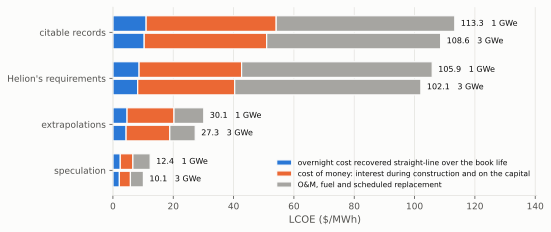
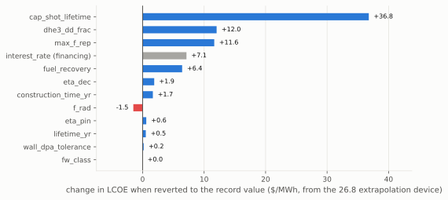
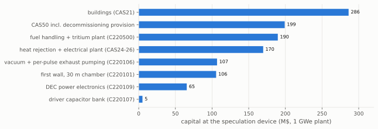
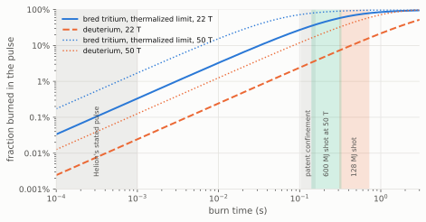
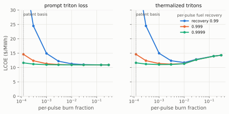

# The techno-economic floor of a Helion-class pulsed inductive fusion power plant

*Tal Rubin and Damien Scott, Astera Institute*

In this work, we investigate how cheap fusion electricity can get if
direct energy conversion is the key technology for harnessing fusion
energy. It is one of six studies, each taking such a thesis to its
physically coherent limit and asking how low the levelized cost of
electricity (LCOE) can be driven.

Direct energy conversion is attractive because its efficiency is not
tied to the working temperature of a conventional working fluid, so it
can convert plasma energy to electricity well above what a steam cycle
reaches. That is not a thermodynamic exemption, and Section 6 prices the
limit it does have. The direct energy conversion system also replaces
the conventional and expensive turbine island. The best fusion fuel for
this purpose is deuterium-helium-3 (D-He3), whose fusion energy is
carried largely by charged particles, and has relatively manageable
photon emissions at fusion conditions.

One of the most efficient physical mechanisms for directly interacting
with the plasma is inductive recovery: a coil-driven magnetic field
compresses the plasma, and the plasma then expands against that field
much as the gas in an engine expands against a piston. That is what
Helion Energy is building, so this work takes Helion's published design
and results as its starting point and builds the argument on them.
Helion's FAQ has projected its cost of electricity production at $0.01
per kWh ($10/MWh) "without assuming any economies of scale from mass
production, carbon credits, or government incentives" [1], and that
figure is what the 1cFE residency at Astera is set on investigating.

**The findings, in brief.** Four devices share the architecture and
differ only in the evidence grade of what they are granted: citable
records alone, Helion's own requirements at face value, labeled
extrapolations, and speculation. They read 112.1, 105.9, 25.7 and 10.5
$/MWh at 1 GWe, and a 3 GWe park of three speculation modules reads 8.2
$/MWh, so the cheapest coherent machine misses the 1 cent/kWh target as
a 1 GWe plant and clears it as a park, on a 3% real cost of capital
worth 6.1 $/MWh there, on a 40 T compression field that no public source
names and whose coil this work does not price, and on a driver bank four
times Polaris's.

Every number grants Helion's shot: a gain of 2.56 on the bank, the ratio
that turns Polaris's 50 MJ into the 50 MWe Helion has contracted to
supply Microsoft, firing at 1 Hz, scaled with the bank at the grades
that enlarge it. Nothing in the record fixes it, so without the grant
there is no machine to cost; every figure here rests on it, the records
device's included.

The fuel cycle, not the driver, is the load-bearing subsystem, because
He-3 has no fleet-scale market: what trades does so by the gram at 19-22
M$/kg, against the 2 M$/kg this study charges. The optimized devices
therefore breed most of their own and buy the rest at a price nothing
supports.

The costing uses the `1costingfe` bottom-up cost model [2], organized by
cost account (the CAS codes in the tables below) and built on publicly
available data and labeled extrapolations; the open-source code is
available [here](https://github.com/1cFE/1costingfe), with detailed
documentation [here](https://files.1cf.energy/1costingfe_paper.pdf), and
the commit is pinned under Reproducibility.

This work is organized as follows: Section 2 describes Helion's device
from the published material, Section 3 defines the four devices and the
constraints they are optimized under, and Section 4 reports their cost.
Section 5 works out the He-3 fuel cycle, and Section 6 bounds what a
shot can return and what the circuit recovers of it, which is where
Helion's shot parts from Helion's stated pulse. Section 7 asks what
would reach $10/MWh and what stands in the way, and Section 8 concludes.

## 2. Machine basis

The machine follows Helion's published architecture at face value
[3, 4]. Two FRC plasmoids, formed by theta-pinch field reversal in
opposed formation sections, are accelerated and merged in a central
compression section, the collision converting their directed kinetic
energy into ion heat, and magnetic compression then does the adiabatic
work to burn conditions. The pulsed-power driver is the only heater.
After the burn the plasma expands against the field, returning driver
energy and charged fusion energy to the coil circuit as work; radiated
power, undirected charged power, and neutrons are not converted.

The design-basis shot is built from three public numbers: the driver
delivers 50 MJ per pulse (the sourced Polaris capacitor bank), the plant
fires at 1 Hz, and Orion, the first plant, is to supply Microsoft at
least 50 MW, which Helion describes as at least 50 MWe after an initial
ramp-up period [3]. The yield per shot is whatever makes the model turn
that shot into 50 MWe at 1 Hz at the burn point Helion's patent
discloses: 128.1 MJ, a gain (fusion yield over delivered driver energy)
of 2.56. The gain is a consistency figure, not a disclosed measurement.

Helion's stated product is the 50 MWe module: its CEO describes a
gigafactory with 50 MW generators coming off the line and leaving on a
truck, one a day [5]. No public source says how many such modules make
up Orion; this work takes it as one, as that framing implies, and the
solved yield scales inversely with the count. The chamber radius is 0.61
m, the smallest at which a 10 m cylinder wall survives the shot under
the tungsten flash bound of 1.5 MJ/m^2 per pulse; the Helion device at 1
GWe is 20 modules at 1 Hz. In general a plant is an integer number of
Helion-class modules, with the repetition rate and module count solved
jointly from the net-power target under a repetition-rate ceiling.

That ceiling, the compression field and the bank are design choices in
this work: a plant may fire slower in more modules, the burn point is
the patent's at the field a device compresses to, and the bank is a
count of modular capacitor units. The next section grades all three by
evidence.

The public record as of September 2026 is D-T fusion on Polaris at 150
million degrees C. Helion has published no yield or recovered energy,
and has withdrawn the term "net electricity" from its Polaris goals [3,
6]. Helion does not report the data inputs a cost analysis needs, and
this work fills each gap with graded evidence tiers (Section 3): the
yield of a burning pulse and its burn time; the energy recovered with
plasma present, which the FAQ says has been measured on seven prototypes
and gives no figure for; the compression density and field of the
reactor point; the per-pulse separation rate and the per-pulse fuel
recovery of the exhaust loop; and the duty cycle at which a machine
fires for hours. The capacitor cost at cycle life, the other datum the
ladder rests on, is a supplier's, not Helion's.

## 3. Method

***Notation.** 1costingfe model parameters keep their configuration-file
names. dd_frac (dhe3_dd_frac) is the D-D share of primary fusion events
by count, not an ion ratio: the patent's He3/D = 0.158 at 70 keV is
dd_frac 0.49, Helion's mix; the 3:1 D:He-3 mix is 0.31; the D-rich mix
is 0.85. dhe3_f_T is the fraction of bred tritium that burns in-pulse.
eta_dec is the circuit efficiency of inductive recovery, f_pdv the
fraction of the plasma's expansion work that reaches the coils, and
their product the composite recovery. chi is the plasma-thermal share of
the delivered driver energy and x_s the separatrix-to-coil radius ratio;
the other parameters are named where they enter.*

### 3.1 Design search and reconciliation

Each device except Helion's own configuration is the minimum-LCOE design
of a scan over the compression field up to its grade's grant, the driver
bank, the shot, chamber length and radius, wall class, seven burn mixes
each sitting on its bremsstrahlung floor, and the firing rate,
discarding any design that violates one of the coherence constraints
below. The shot is pinned to the design-basis gain of 2.56 except at
speculation, where the scan chooses the gain.

Each device's firing-rate ceiling is the lowest of its grade's grant,
the rate at which one shot's burn would fill the pulse period, and its
wall's flux bound. The rate is scanned down from there in steps, each
forcing more and slower modules.

Each device is quoted at its minimum and bracketed by a reconciliation
band. The band's top adds the two costs the model names but cannot price
internally, the high-voltage DC switch duty and the
driver-thermalization derate; its bottom credits the one conservatism,
no thermal bottoming. The tritium plant, carried as a range rather than
a point, moves both ends.

### 3.2 The field and the bank, graded

Neither is pinned at its sourced value, because those values are an
experiment's rather than a plant's: Polaris's bank, and the patent's
burn point, which is the highest field in the record. Both are scanned
instead, and of the two the field is where nearly all of the saving
comes from.

The field is a stepped entry of the ladder: 22 T at the design basis and
records, the field the patent's operating point (0.75e22 m^-3 at 70 keV)
implies at beta = 1, corroborated by Helion's stated compression field
of more than 15 T; 30 T at extrapolations, with no public roadmap behind
it; and 40 T at speculation, an explicit leap. The upper two are grants
rather than records. One step above each grade's field, 30, 40 and 50 T,
is priced as a labeled sensitivity excluded from that grade's devices.

The bank is held at Polaris's 50 MJ at the records grade, doubles to 100
MJ at extrapolations and reaches 200 MJ at speculation. Doubling it is a
procurement rather than a technology, since a bank is a count of the
modular capacitor units Helion is tooling its Omega facility to produce
for Orion, about 2,500 of them [7].

The burn point follows the field. At beta = 1 and the patent's ion
temperature the density scales as B^2, and the rest follows: the
breakeven time, the burn a plasma needs to return its own energy, falls
as B^-2; the per-pulse burnup and the magnetic pressure rise as B^2; the
compressed flux volume E_del/(B^2/2mu0) falls as B^-2 and grows with the
bank. The coils are priced at the field and the driver per joule, and
the wall's steady flux and per-shot flash follow the fusion power and
the shot.

### 3.3 Evidence ladder

The plant environment is held in part and stepped in part. Every entry
is engineering except the cost of capital, which is financing and is
reported separately:

- Held at every grade: constant-dollar framing, and EPCM indirects at
  20% of direct cost [8], which the model scales with the build time
  (CAS30 = fraction x CAS20 x (construction_time_yr / 6 yr)), so the
  effective fraction is 16.7% at a 5-year build, 10.8% at 3.25 years and
  8.3% at 2.5 years.
- Construction time, stepped: 5 years at the design basis and records
  grades (the serial Hualong One builds, about 60 months from first
  concrete to grid [9]), 3.25 years at extrapolations (the
  Kashiwazaki-Kariwa ABWR pair, 37 and 39 months from first concrete to
  fuel load [10], at the peak of a mature light-water supply chain), 2.5
  years at speculation (a combined-cycle gas turbine timeline for a
  fusion module with a tritium facility).
- Cost of capital, stepped: 7% real at the design basis and records
  grades (the IEA/NEA central case [11]), 5% at extrapolations (a
  loan-guarantee blend with precedent), 3% at speculation (the IEA/NEA
  low case [11], sovereign-class capital).
- Book life, stepped: 60 years through the records grade, a
  series-consistency entry rather than a record, adopted because the
  companion studies hold 60 at their records grade. It sits below the
  licensed bound of 80 years [12] and above the fusion literature's
  30-40 year cluster [13]. 80 years from the extrapolation grade (the US
  DOE hydropower lifespan [14]). Every core component is replaced on its
  own schedule and the unreplaceable structure sees negligible fluence.
- Availability, derived: 0.98 outside planned outages, less a routine
  outage every two years [15], a capacitor-bank swap at the bank's shot
  life, and a wall-and-coil changeout at the displacement-damage
  tolerance (dpa, displacements per atom; 20 dpa through the records
  grade, 50 above it): 0.893 at the records device and 0.925 at
  speculation, against the fusion literature's 0.75 to 0.90.

The performance entries step the same way. Two are requirements Helion's
design implies rather than publishes: per-pulse fuel recovery, which the
He-3 economy needs to close, held at 0.999 on the records device by the
JET fuel-retention analogy with its ITER-like wall [16] and at four
nines on the Helion device; and the shot, which has no value to revert
to, so every device is granted it. The cheaper stacks keep both grants
and add more, the largest being capacitor life 1e9 shots [17]. Every
entry carries a source and grade in `docs/ledger.md`, and no
extrapolation entry is a measured record.

### 3.4 Coherence constraints

Eight couplings are carried on every quoted point. Constraints 1, 2, 3,
5 and 8 are enforced by the scripts as checks; 4, 6 and 7 are applied by
construction:

1. The radiated fraction is a function of the burn mix through a
   bremsstrahlung floor, because a deuterium-rich plasma radiates more
   of its fusion power, not less: 0.28 at dd_frac 0.85 against 0.20 at
   Helion's 0.49. Helion's own patent figure, 0.23, sits above its
   floor, so the Helion device is priced at the patent's value.
   Independent reconstructions put Helion's fusion-to-bremsstrahlung
   ratio 3.6 to 9 times [18] or about an order of magnitude [19] too
   favorable, which would put the radiated fraction well above the
   floor.
2. Recovery efficiency is capped as the composite eta_dec x f_pdv (0.80
   through the extrapolation grade, 0.90 at speculation), because the
   only published figure speaks to the product.
3. The wall must survive two loads. Its steady flux must stay within the
   limit its wall class is qualified to, what the coolant carries away
   continuously; and its per-shot flash, deposited in about a
   millisecond before conduction can spread it, must stay under the
   tungsten melt bound of 1.5 MJ/m^2, taken with no margin. Two classes
   are purchasable: a panel wall of the ITER first-wall kind, qualified
   to about 2 MW/m^2 at 0.35 M$/m^2, and a divertor-class monoblock
   qualified to 10 MW/m^2 at 2.5 M$/m^2.
4. A mix with dd_frac at or above Helion's 0.49 carries its
   tritium-plant consequences, priced as an added fuel-handling cost of
   50 M$ fixed plus 0.657 M$ per MW of plant neutron power: a
   unit-priced allowance rather than a costed scope.
5. The in-plasma tritium burn dhe3_f_T is floored by the per-pulse
   burnup, so a low-burn claim at high per-pulse burnup is flagged as
   requiring prompt triton loss. The floor rises as B^2 with the burnup:
   0.16% at the patent basis, 0.31% at the 30 T extrapolation grant and
   0.54% at the 40 T speculation grant, all inside the 1% tolerance, so
   every device's zero passes. Section 5.2 derives the floor and prices
   the 40 T value rather than the zero.
6. The expansion-work recovery fraction is capped per point: f_pdv =
   min(claim, 1 - (V_i/V_f)^(2/3)), where the claim is the grade's
   asserted f_pdv (the basis 0.80 through the extrapolation grade, 0.947
   at speculation, f_pdv alone and not constraint 2's composite, which
   at speculation is eta_dec 0.95 x 0.947 = 0.90), V_i the compressed
   flux volume at the point's own bank and field, E_del/(B^2/2mu0), and
   V_f the chamber, the whole volume stroke counted (Section 6).
7. The shot yield is bounded by the plasma energy and the burn time,
   gain <= chi x burn time / breakeven time, with the breakeven time
   evaluated for the plasma at the burn point of the point's own field
   and at the mix the point actually burns (purchased He-3 plus the bred
   He-3 that recycles), so every quoted point carries the burn time its
   shot implies, and the shot takes each device's grade rather than
   serving as a shared basis (Section 6).
8. A shot's implied burn must fit inside the pulse period: burn time x
   repetition rate <= 1, because one burn section holds one plasmoid and
   the next shot cannot fire while the last is still burning. The bound
   is hard at 1.0, reserving nothing for exhaust, refill and recharge.

## 4. Results: the four devices and what carries the cost floor

| device | field, bank, shot | 1 GWe | 3 GWe | at 7% real cost of capital, 1 GWe |
|---|---|---|---|---|
| citable records | 22 T, 50 MJ, 128 MJ | 112.1 | 108.2 | 112.1 |
| Helion's requirements | 22 T, 50 MJ, 128 MJ | 105.9 | 102.1 | 105.9 |
| extrapolations | 30 T, 100 MJ, 256 MJ | 25.7 | 22.9 | 32.6 |
| speculation | 40 T, 200 MJ, 800 MJ | 10.5 | 8.2 | 17.6 |

LCOE in $/MWh, carried to one decimal for traceability; the cost basis
does not resolve that finely, so a difference of a few tenths is within
precision and not a difference. The at-7% column holds everything else
unchanged, so its gap from the 1 GWe column is what the grade's cheaper
money is worth. Every device is a panel-wall machine, and each 3 GWe
park is the same module tripled. Reconciliation brackets the two cheap
devices at 21.3-29.9 and 9.8-11.6 $/MWh. The stack and design behind
each row:

- **citable records**: fuel recovery 0.999 (JET analog), 7% real cost of
  capital, 60-year life, 5-year build, the patent field and Polaris bank
  since no record exists above either, and Helion's 128 MJ shot granted.
  Optimum: that shot at the deuterium-rich dd_frac 0.85 with its tritium
  plant, the mix that breeds more He-3 than it burns, in 25 modules of
  10 m x 0.75 m at 0.985 Hz under the 1 Hz grant, the fewest modules
  whose rate fits its 1.01 s burn, at 99.9% of the duty bound.
- **Helion's requirements**: the records stack on Helion's own
  configuration, a 50 MJ driver at 22 T, 20 modules in the smallest
  chamber that survives the shot, and Helion's mix (dd_frac 0.49) with
  its 0.23 bremsstrahlung fraction and tritium plant, granted its two
  unrecorded claims: the 128 MJ shot that delivers the 50 MWe module at
  1 Hz (a 0.3 to 0.7 s burn at the patent point, against Helion's stated
  pulse) and fuel recovery 0.9999.
- **extrapolations**: the records stack with Helion's gain and four
  nines of fuel recovery, plus capacitor life 1e9 shots, a 3 Hz rate
  ceiling, 5% real cost of capital, an 80-year civil-works life and a
  3.25-year build; the field granted to 30 T and the bank doubled to 100
  MJ. Optimum: 256 MJ shots at the deuterium-rich dd_frac 0.85 with its
  tritium plant, in 4 modules of 15 m x 1.5 m at 2.37 Hz, held there by
  the panel wall at 97% of its limit rather than by the grant; the 3 GWe
  park is 12 of them. The field is worth 3.4 $/MWh and the doubled bank
  0.3, within precision.
- **speculation**: the extrapolation stack, plus a 10 Hz ceiling, the
  composite recovery at its theory optimum 0.90, capacitors at 0.1 $/J
  and 1e10 shots, He-3 at 0.5 M$/kg, 3% real cost of capital and a
  2.5-year build; the field granted to 40 T, the bank free to 200 MJ and
  the gain free. Optimum: 800 MJ shots at a gain of 4.0 at the
  deuterium-rich dd_frac 0.85 with its tritium plant, in a single module
  of 30 m x 1.5 m at 2.23 Hz, held there by the panel wall at 99.7% of
  its 2 MW/m^2 limit; the 3 GWe park is 3 of them. The field is worth
  1.2 $/MWh, and the quadrupled bank and the freed gain nothing within
  precision.

The cost tracks module count, and the firing rate sets it: each added
module costs about 1.5 $/MWh of hardware, more than a bank swapped less
often saves, so the optimum at every mix is the fewest modules whose
rate fits. At the extrapolation device's shot, chamber and mix the rate
ladder reads 25.7 $/MWh in the 4 modules at 2.37 Hz the wall admits and
30.3 in 7 at 1.36 Hz, a wider spread than the 30 T grant itself buys.
Two bounds set that rate. At 22 T it is the duty of constraint 8,
because the deuterium-rich plasma is power-sparse, its breakeven time
206 ms against 65 ms at Helion's mix: the records device's burn fills
its period, and the extrapolation design fired at its 3 Hz grant in 4
modules is excluded for overrunning its period at a duty of 1.62. At 30
and 40 T the burn shortens as B^-2, the duty bound relaxes, and the wall
of constraint 3 binds first, capping the extrapolation device's 4
modules at 2.44 Hz and the speculation device's one at 2.24.

Every optimized device burns deuterium-rich rather than Helion's
published mix, and the saving over that mix shrinks up the ladder, from
36.7 $/MWh at the records grade to 1.1 at speculation. It is a fuel bill
rather than physics, and the upper grades shrink it themselves: the
fourth nine of recovery wastes less He-3 per pulse, and at 0.5 M$/kg
what is still bought is cheap. With He-3 free the ranking inverts at
every grade and the He-3-rich preset wins, 19.9 $/MWh at extrapolations
and 8.3 at speculation (`scripts/he3_scan.py`).

The two cheap devices are held by the heat their first wall can carry
away, running at 97 and 99.7% of the panel wall's 2 MW/m^2 steady-flux
limit. The divertor-class wall that would lift that limit costs seven
times as much per square meter and loses to more panel chamber at both
grades. The wall is also why more field buys so little: a step above
each grant is worth 0.4 $/MWh at extrapolations and 0.2 at speculation.

None of the devices has margin left at its own bound. The speculation
module fires 0.2% under its rate ceiling, so any perturbation that costs
it net power per shot (Section 5.2 prices one) adds a second module at
1.4 $/MWh, and the records device fires at 100% of its duty bound,
nothing in the period reserved for exhaust, refill and recharge.

The 6.2 $/MWh between the records device and Helion's requirements,
112.1 against 105.9, is one claim: the fourth nine of per-pulse fuel
recovery, which the records device reverts to the JET-supported three
nines. It costs so little because that device's deuterium-rich burn
breeds most of its own He-3.

*Figure 1: One device per evidence grade, at 1 and 3 GWe. Each bar
splits three ways: overnight cost, recovered straight-line over the book
life (blue); the cost of money, interest during construction and on the
capital (orange); and O&M, fuel and scheduled replacement (grey). Cost
of capital and book life step with the grade.*

Reverting one entry of a cheap device's stack to its record value,
everything else held, prices that entry: the rise in LCOE is what the
grant was worth. The ranking below reverts the extrapolation device,
which changes what is bought: each entry is a labeled step beyond a
record with a physical argument behind it that a measurement could
confirm or refute. The account breakdown after it is drawn from the
speculation device, which changes prices and ceilings with no mechanism
behind them and is the floor.

From the 25.7 $/MWh extrapolation device:

| parameter reverted | LCOE ($/MWh) | delta ($/MWh) |
|---|---|---|
| cap_shot_lifetime -> 1e8 shots | 61.9 | +36.2 |
| dhe3_dd_frac -> 0.49, Helion's mix, with its 0.23 radiated fraction (4 modules at 2.09 Hz) | 37.2 | +11.4 |
| max_f_rep -> 1 Hz (10 modules at 0.96 Hz against the device's 4 at 2.37) | 35.0 | +9.2 |
| interest_rate -> 0.07 (financing) | 32.6 | +6.9 |
| b_center -> 22 T, the patent basis, with the ceiling re-solved at the duty bound of the 0.68 s burn (7 modules at 1.37 Hz) | 31.1 | +5.4 |
| fuel_recovery -> 0.999 (JET-analog; the leaner recycled plasma costs a fifth module, at 1.97 Hz) | 30.6 | +4.8 |
| e_driver_mj -> 50 MJ, the Polaris bank, at the design-basis gain in the device's own chamber (8 modules at 2.39 Hz) | 28.5 | +2.8 |
| eta_dec -> 0.85 (5 modules at 2.13 Hz) | 28.0 | +2.3 |
| construction_time_yr -> 5 yr | 27.3 | +1.6 |
| lifetime_yr -> 60 | 26.3 | +0.6 |
| eta_pin -> 0.95 (driver wall-plug) | 26.3 | +0.6 |
| wall_dpa_tolerance -> 20 | 25.9 | +0.2 |
| f_rad -> 0.23 (Helion's own; below the 0.28 floor at dd_frac 0.85, so not a coherent point) | 25.2 | -0.5 |

The rows that need a word more:

- the capacitor cycle life (36.2 $/MWh) dominates every other lever. At
  the 1e8-shot record the whole shot-cycled recovery chain is replaced
  about 17 times over a 60-year life, which is what holds the records
  and Helion devices above 100 $/MWh.
- the firing rate (9.2 $/MWh) is the step from 4 modules to 10 when the
  ceiling reverts to 1 Hz. The device fires at 2.37 Hz, so grant above
  2.4 Hz is worth nothing to it.
- the field (5.4 $/MWh), the bank (2.8) and the mix (11.4) are reverted
  in the device's own chamber, the field with the rate re-solved for the
  0.68 s burn its shot needs at 22 T. Redesigned around each reverted
  value instead, they are worth 3.4, 0.3 and 9.6.
- the fourth nine of fuel recovery (4.8 $/MWh) is worth 47 at Helion's
  own mix, because this device breeds most of its He-3 and at 30 T burns
  1.9 times more of it per pulse (Section 5.2).

f_pdv and the shot are absent from the table: the stack leaves f_pdv at
the basis 0.80, under a cap that does not bind, and the shot has no
record value to revert to.

*Figure 2: Each extrapolation entry reverted to its record value, one at
a time, from the 25.7 $/MWh device. The grey bar is the financing entry
and every other bar is physics or engineering; the reversions that leave
the coherent set are marked in the table above.*

At the speculation device the driver bank is no longer where the money
goes: it is 20 M$ of the single module's 645 M$ reactor account. What
carries the floor instead is site and support infrastructure,
operations, and the capital of the module itself:

| item | M$ | $/MWh (approx) |
|---|---|---|
| buildings (CAS21) | 288 | 1.2 |
| CAS50, the decommissioning provision and supplementary capital | 198 | 0.8 |
| fuel handling (C220500), of which the tritium-plant allowance 143 | 183 | 0.7 |
| heat rejection + electrical plant (CAS24-26), no turbine island, so not a steam cycle | 171 | 0.7 |
| first wall of the 30 m chamber (C220101) | 106 | 0.4 |
| direct-conversion power electronics (C220109) | 76 | 0.3 |
| vacuum and exhaust (C220106), of which per-pulse pumping 24 | 53 | 0.2 |
| adiabat-priced coils (C220103), conductor only, with no structural reinforcement | 28 | 0.1 |
| driver capacitor bank (C220107) | 20 | 0.1 |
| O&M (CAS70), levelized in constant dollars | 34/yr | 4.3 |
| fuel (CAS80): He-3 at 0.5 M$/kg, net of the decay store's return | 2/yr | 0.2 |
| annualized capital, all-in (3% real cost of capital, 80 years) | 49/yr | 6.0 |

*Figure 3: Capital accounts at the speculation device. The driver bank
is the smallest bar and site infrastructure the largest; O&M, outside
the chart, is seven tenths of the annualized capital in the levelized
cost.*

## 5. The He-3 fuel cycle, the load-bearing subsystem

Tritium for a D-T reactor has to be bred because no one sells it at
reactor scale. He-3 is in the same position: bought rather than bred,
each of these devices would need 20 to 176 kg of He-3 a year, and no
route supplies that. So breeding buys this plant out of the He-3 market,
and what it buys into is a tritium inventory of tonnes: unlike a D-T
blanket, which breeds and burns in one loop, this cycle holds its
intermediate for a 17.8 yr mean life before it is fuel.

United States production is about 1 kg a year, nearly all of it from
tritium decaying in the weapons stockpile [20]. Transmutation using an
accelerator has a full design record, the DOE's Accelerator Production
of Tritium plant, a 1.7 GeV 100 mA linac drawing 170 MW of beam for 3 kg
of tritium a year [21]; the speculation device's 20 kg/yr would take
seven of them and more power than the plant sells. Lunar extraction has
sales agreements and no delivered He-3, and the world's civilian
heavy-water tritium stock, 25-30 kg, yields about 1.4 kg/yr as it
decays.

The prices on record are all small-volume. The DOE Isotope Program's
2011 allocation was 600 $/L to federal users and 1,000 $/L to commercial
users [20], 4.5 and 7.4 M$/kg. The 2024-2026 transactions sit at 19-22
M$/kg on gram-to-kilogram volumes, four to five times that allocation:
spot near $2,500/L per the Edelgas Group [22], Interlune's agreements
with the DOE Isotope Program and Maybell Quantum "at today's commercial
market price". The 2 M$/kg this study charges sits below both, and the
speculation entry, 0.5 M$/kg, nine times below the 2011 allocation.

The fuel cycle is the one in Helion's patent [23], whose operating table
also fixes the burn point: the patent's mix (dd_frac 0.49) at 70 keV and
22 T radiates 23% of its fusion power as bremsstrahlung and releases 6%
as neutrons. Slough [24], citing the same patent, restates that mix as
the self-sustained cycle's limit, He-3 at roughly 16% of the fuel.

The D-D reactions are what close the cycle. Half of them produce a He-3
atom directly, the prompt branch; the other half produce a triton, 0.5
dd_frac per primary event, a quarter of them at Helion's mix and two
fifths at the optimized devices. That triton is pumped out with the
exhaust after the pulse, separated, and stored on getter beds until it
decays into He-3 (12.3 yr half-life), and almost none of it burns before
it is removed (dhe3_f_T = 0 in the basis). The plant therefore has no
lithium anywhere, and its tritium plant is an exhaust-processing and
storage plant.

The cycle rests on four conditions. The ladder prices three of them:

- the price of the He-3 it still buys. The optimized devices breed most
  of their own, so the fuel line is only 1.3 $/MWh at the extrapolation
  device and 0.2 at speculation.
- a site inventory of tritium held while it decays, tonnes of it at
  every device, whose plant and safety envelope are the allowance of
  constraint 4.
- per-pulse fuel recovery at four nines, the fourth of which is worth
  4.8 $/MWh at the extrapolation device.

The fourth condition is not a price but a fact about the pulse: the
store works only if bred tritium leaves the plasma before it burns. At
Helion's stated pulse it does. At the longer burn the granted shot
needs, it does only if the plasmoid loses its tritons promptly, and
every device rests on that loss as well as on the shot.

### 5.1 What breeding buys and what it costs

The He-3 released from the store replaces purchased He-3 atom for atom,
building from empty as 1 - e^(-t/17.8 yr) and covering the 1 - dd_frac
the plant burns only at equilibrium. This work levelizes the credit over
the book life at the grade's rate, as a scaling of the He-3 price
outside the cost model, and the prompt bred He-3 counts as extra burns
rather than supply.

A deuterium-rich plant therefore buys He-3 only until the store covers
its need. Against the full bill, every atom it burns bought for the life
of the plant, its levelized purchase is 22% at the records device, 16%
at extrapolations and 11% at speculation, the share falling as the
granted field rises, because more of the bred He-3 then burns per pass
instead of leaking out of the recovery loop. A mix that breeds less than
it burns keeps buying: Helion's own device pays 79%. That exposure is
what the mix is worth. At the ledger price the full bill would cost
Helion's device 5.2 $/MWh more and the records device 35.3, and free
He-3 would save them 19.7 and 9.7, which would also change the mix
(Section 4).

At the 2011 federal allocation, 600 $/L or 4.5 M$/kg, the extrapolation
device reads 27.2 $/MWh against 52.3 for Helion's mix in the same
chamber at the same rate, and at the commercial spot 36.3 against 152.6.
Breeding most of its He-3 makes it far less exposed than Helion's mix,
but not indifferent: the spot adds 10.6 $/MWh. A richer mix still,
dd_frac 0.95, breeds nearly all it burns and reads 26.6 to 27.9 across
the whole price span.

The store that breeding implies is large. Every module breeds tritium at
half its D-D rate, 38 kg/yr across Helion's plant and 53 to 145 at the
optimized devices, and store-for-decay fixes the equilibrium inventory
at that rate times the 17.8 yr mean life: 0.67 tonnes at Helion's
device, 2.6 at the records device, 1.3 at extrapolations and 0.9 at
speculation. A tonne is 1e10 Ci, about 320 kW of continuous decay heat,
250 times ITER's site authorization and 35 times the world's civilian
tritium stock. The inventory is intrinsic to breeding at this scale;
shipping it to a central fuel facility relocates it, and can hold the
reactor site near ITER-class inventory with weekly pickups, but cannot
shrink it.

The store's hardware is the allowance of constraint 4, and probably an
underestimate: 50 M$ of fixed core, isotope separation at the firing
rate with the safety envelope and the getter beds, plus 0.657 M$ per MW
of plant neutron power, 180 M$ at the extrapolation device and 143 at
speculation. Its licensing posture is carried by holding the site,
decommissioning and O&M analogs at fission class rather than gas class,
a refusal Section 7 prices at about 2.0 $/MWh.

A plant can buy its He-3 instead of breeding it, holding 80 kg rather
than 900: the He-3-rich preset, which breeds only 4.6 kg/yr, reads 12.1
$/MWh at 1 GWe against the device's 10.5. The smaller inventory costs
1.6 $/MWh.

The alternative to breeding in the power module is a dedicated deuterium
breeder: a pure-D module of the same grade with its bred He-3 and
tritium pumped out every pulse, priced per kilogram delivered as module
ownership plus a throughput-sized tritium plant plus its net power at
the device's own LCOE (`scripts/breeder_loop.py`). It delivers at 2.0
M$/kg at the records grade, the ledger's own price, at about 0.7 at
extrapolations and 0.2 at speculation against the ledger's 2 and 0.5,
and at 6.6 at the Helion device, which therefore cannot self-supply at
the price it is charged. The two cheaper grades move neither device
outside its precision, 25.0 against 25.7 $/MWh and 10.4 against 10.5,
and the breeder relocates the tritium inventory rather than shrinking
it.

### 5.2 Fuel recovery and the burnup closure

Helion's cycle depends on pumping the bred tritium out of the exhaust
before it burns, so the store-and-decay idealization (dhe3_f_T = 0: no
bred triton burns in-plasma) is a claim about pulse length, not a
modeling choice. A triton born mid-pulse sits in a deuterium-rich plasma
at fusion temperature for the rest of the burn, and D-T reactivity is
27-87x D-D at 70-20 keV [25], so each unit of D burnup burns 14-43x as
much of the bred tritium. The per-pulse deuterium burnup pins the
integrated exposure x_DD = -ln(1 - f_D) = n_D <sigma v>_DD tau, and the
thermalized-limit in-pulse tritium burn is

    f_T = 1 - (1 - e^-x)/x,  x = (sv_DT / sv_DD) x_DD,

the fraction of a pulse's bred tritium that fuses before the pulse ends
and so never reaches the exhaust to be pumped. A triton born at the
start of the burn sees the full exposure x and burns with probability
1-e^-x, one born at the end sees none, and the expression is the average
over birth times; its only physics input is the reactivity ratio. Prompt
orbit loss from the plasmoid, whose separatrix sits only a few ion
gyroradii from the field null, is the one mechanism that can hold the
burn below this floor; beam-target burn of the slowing triton can only
add to it. This closure is constraint 5: any quoted point whose dhe3_f_T
sits materially below the floor is flagged as coherent only under prompt
triton loss.

The basis is the patent's burn point, n_D = 0.75e22 m^-3 at 70 keV, at
Helion's stated pulse rather than the patent's confinement time of 0.10
to 0.16 s: that time implies an n tau of 2-3e21 s/m^3, three to four
orders above the n tau any FRC has reached on the uniform Lawson ledger
[26], and is the reason the shot is graded rather than priced. Over a
full confinement period a thermalized triton would burn 28-38%, the
patent's own case for inter-pulse removal.

Over a sub-millisecond pulse the burnup is 1.2-2.5e-4 and the floor on
the in-pulse tritium burn 0.16-0.3%, inside the 1% tolerance constraint
5 allows: at the patent point, where the records and Helion devices sit,
the burnup would have to triple before dhe3_f_T = 0 broke it. The floor
scales with the density, so the granted fields raise it, to 0.54% at the
speculation device's 40 T, still half the tolerance.

The stated pulse is not the burn the shot needs. Constraint 7 puts the
design-basis shot at a burn of 0.3 to 0.7 s, over which a thermalized
triton burns 58 to 80% before removal; the speculation device's 800 MJ
shot needs 0.15 to 0.34 s, shorter because its 40 T plasma reaches
breakeven 3.3 times faster, and over that a triton burns 70 to 87%. The
store-and-decay cycle and the granted shot are coherent together only
under prompt triton loss, the branch the burnup axis of Figure 5 prices
at high burnup.

*Figure 4: The per-pulse deuterium burnup and the thermalized-limit
in-pulse burn of a bred triton against burn time, at the patent point
(0.75e22 m^-3, 70 keV) and at the speculation device's 40 T point, 3.3
times that density. The shot bands span x_s 0.5 to 0.85 under constraint
7. The store-and-decay basis holds at Helion's stated pulse; at the burn
the granted shot needs, most bred tritium burns in the pulse unless it
is promptly lost.*

Fuel therefore resides in the machine of order a thousand pulses before
burning. The model carries the per-pulse pair burn_fraction = 1.2e-4 and
burn_fraction_he3 = 4.1e-4 at the basis field, He-3 burning 3.3x faster
per pass, scaled as B^2 with the density at a device's own field, and
charges the recycle losses per species in the fuel account.

A recirculating nucleus faces the same race every pass: burn with
probability bf (burn_fraction) or leak with probability 1 - fr
(fuel_recovery). Its ultimate fate is the geometric series bf / (1 - fr
(1 - bf)), set by the ratio of the two rates:

| species (per-pass burn) | fr = 0.99 | fr = 0.999 | fr = 0.9999 |
|---|---|---|---|
| deuterium (1.2e-4 at 22 T) | 1.2% burns | 11% burns | 55% burns |
| He-3 (4.1e-4 at 22 T, the records and Helion devices) | 3.9% burns | 29% burns | 80% burns |
| He-3 (7.6e-4 at 30 T, the extrapolation device) | 7.1% burns | 43% burns | 88% burns |
| He-3 (1.4e-3 at 40 T, the speculation device) | 12% burns | 58% burns | 93% burns |

At three nines the loop is primarily a fuel-disposal device, wasting 71%
of its He-3 at the basis field, and at two nines nearly everything
leaks. The granted fields tilt the race toward burning, which is part of
what the field is worth at each grade and why the fourth nine is worth
less there.

Tritium sees no geometric series at all: it is extracted to the store on
its first pass, so separation loss hits it once rather than compounding.

With per-pulse reprocessing the unburned-fuel repurchase multiplier at
the basis field is 84x at per-pulse recovery 0.99, 9.3x at 0.999 and
1.8x at 0.9999 (46x, 5.5x and 1.5x at 30 T; 26x, 3.5x and 1.3x at 40 T).
A deuterium-rich plant is self-sufficient in He-3 at three nines, so the
multiplier bites only on what it buys while the store builds up, 3.5
$/MWh on the deuterium-rich extrapolation stack in Helion's chamber at
30 T; the fourth nine is worth 47 $/MWh at Helion's device, whose mix
breeds less than it burns, 4.8 at the extrapolation device and 1.9 at
speculation, which breed most of their own at fields where the loop
wastes less.

No per-pulse measurement supports any point on this axis: the JET
retention figure behind the three nines is campaign-scale co-deposited
inventory over many wall recycles, which could overstate single-transit
loss or understate it once a per-pulse separation plant's slip is added
[16].

Both species' per-pulse burn fractions derive from the same n tau, so
the axis sweeps coherently: burn_fraction_he3 tracks burn_fraction at
the fixed 70 keV reactivity ratio, 3.3x. Figure 5 shows the speculation
device's LCOE along that axis under both triton fates, at per-pulse fuel
recovery 0.99, 0.999 and 0.9999.

At the speculation device's own point, 4.0e-4 at 40 T, per-pulse fuel
recovery sets the cost almost alone on the prompt-loss branch: 10.5
$/MWh at four nines, 12.3 at three and 17.0 at two, against 106, 155 and
639 $/MWh at Helion's device, which sits at the patent point and buys
more of its He-3.

On the thermalized branch the tritium that fuses in the pulse puts 14.1
MeV of each reaction into a neutron this plant does not convert to
electricity, so every shot nets less; firing faster to make it up is
closed off, because the device's single 30 m burn section already runs
0.2% under the rate ceiling its wall imposes. The plant therefore splits
into two modules at 1.12 Hz, and that second module, not the 0.54% of
bred tritium that burned, is the 1.4 $/MWh between the branches, 11.9
against the prompt-loss 10.5.

Further up the burnup axis each nucleus burns sooner and makes fewer
passes, so the recovery grade stops mattering: above a per-pulse burnup
of about 1e-3 the three- and four-nines curves converge, at 11.8 $/MWh
on the thermalized branch and a floor of 10.3 on the prompt-loss one.
The relief does not last, because half of every D-D event breeds a
triton and 85% of this device's events are D-D: between burnup 0.003 and
0.3 the in-pulse burn of that tritium climbs from 4 to 90%, carrying the
thermalized branch to 14.8 $/MWh. The triton-fate question reopens
exactly where the recovery question closes.

The prompt-loss branch is a bound on the fuel cycle rather than a design
to choose: the orbit loss that spares the tritium also ejects the fusion
protons, about four fifths of the charged fusion energy at the
deuterium-rich mix, and the branch's prices do not carry that loss.

*Figure 5: LCOE at the speculation device along the per-pulse burnup
axis. The patent-density basis is the hardest point for fuel recovery;
at the device's own field, 40 T, the step on the thermalized panel is
the second module the wall-bound single module snaps to.*

### 5.3 Neutron damage and the unshieldable throat

The replacement rate follows from the 14 MeV-equivalent neutron wall
load and a dpa tolerance: damage accrues at 10 dpa per MW yr/m^2 in
Fe-based structure, with the 2.45 MeV D-D flux folded in at 0.4. The
tolerance is taken at 20 dpa, the edge of the irradiation database for
reduced-activation ferritic-martensitic steel, and at 50 dpa, the
DEMO-class design target. The event carries both the wall and the
close-coupled coils (106 + 28 M$ in the speculation device's single 30 m
chamber, 211 + 61 across the extrapolation device's four), since nothing
0.10 m behind the wall outlives it.

The devices are priced with no in-pulse tritium burn, so the spectrum is
pure 2.45 MeV D-D and the 14 MeV-equivalent load follows the mix and the
duty: 0.05 MW/m^2 at Helion's device, 0.12 and 0.13 at the records and
extrapolation devices, and 0.19 at the speculation device, whose one 30
m wall carries a plant's neutrons at the deuterium-rich mix. That prices
at 0.3 $/MWh or less at the 50 dpa design target, and 0.2 to 2.6 at the
20 dpa database edge.

These are the favorable end of the load. Section 5.2's floor puts 0.16
to 0.54% of the bred tritium into the pulse, and a 14.1 MeV neutron
displaces about 14 times as much as the D-D neutron it stands beside, so
charging the floor rather than zero adds 2 to 8% to the dpa rate, on
damage that accumulates for the life of the component.

Damage is small at these devices only because they sit at vanishing
burnup with no in-pulse tritium burn, and the regime that would relieve
the recovery requirement is the one that ends both conditions. At 15 to
30% of the deuterium burning per pulse a thermalized triton burns up to
90% of the bred tritium in-pulse, and the speculation device's wall load
rises to 1.14 MW/m^2, six times the 0.19 it is priced at.

Prompt loss and thermalized confinement then part by 10 to 21 $/MWh at
the speculation device and 17 to 33 at the extrapolation device once
wall replacement is counted, across the 50 and 20 dpa tolerances; on a
divertor-class wall at 2.5 M$/m^2, the extrapolation stack in Helion's
chamber, replacement is prohibitive at +51 to +152 $/MWh. Keeping the
tritium out of the burn is therefore cheap insurance at the devices' own
points and worth double digits off them.

Shielding cannot buy the machine out of this, because a pulsed inductive
plant pays per pulse for every cubic meter between coil and plasma: it
stores W = (B^2/2mu0) x annulus volume, and the circuit returns only
eta_dec of that, 0.85 to 0.95 across the grades. A 0.4 m shield under
the compression coil multiplies the 0.26 to 0.31 m^3 annulus by more
than an order of magnitude, so the driver stores several hundred MJ a
pulse and dissipates tens of MJ of it every shot: order 100 MW or more
of recirculating loss, owed on a vacuum shot with no plasma in the
chamber. The plasma side follows, since the larger delivered energy
raises V_i in constraint 6's cap on f_pdv. The B^2 makes all of it worse
at the granted fields, 1.9 and 3.3 times the basis, so shielding is
affordable only far from the burn, and the coils nearest it are
sacrificial, ceramic-insulated, and on the wall-replacement schedule.

The audit also spreads the neutrons uniformly over the chamber while the
burn sits near the compression section, so a localized audit would
roughly double the damage costs, and at the speculation device nothing
averages that away: one 30 m chamber carries the plant's whole 1.79 GW.

The wall and coils are 134 M$ of the speculation device's 645 M$ reactor
account (272 of 1524 at the extrapolation device), so their levelized
replacement outspends the account's own capital service below an
interval of about 5.7 years at the speculation grade's 3% real cost of
capital (2.8 at 7%) and 3.3 years at the extrapolation grade's 5%. The
derived intervals are well clear of it: 27 years at the speculation
device and 39 at the extrapolation device at 50 dpa, 17 at the records
device at the 20 dpa edge. The consumable-core regime, 1-3 year
intervals with a fifth of the module's value swapped near-annually,
belongs to the high-burnup thermalized counterfactual, where the plant
becomes a manufacturing operation with a waste stream this study does
not price.

## 6. What a shot can return, and what the circuit recovers of it

Three of Helion's public numbers cannot hold together: the shot Orion
needs, the plasma conditions in the patent, and the stated millisecond
pulse. At that pulse the fusion energy a shot returns is a fraction of
what the circuit loses in firing it, and the shot needs a burn hundreds
of times longer than Helion describes. That makes the disclosed design
point incoherent, not the machine impossible: something Helion has not
said publicly would have to close the gap, or the patent no longer
describes the machine. The bounds below sit beyond the composite cap of
constraint 2, which only stops the two conversion efficiencies from
being counted twice.

### 6.1 The yield bound

The plasma at peak compression holds a share chi of the delivered driver
energy E_del, the bank's 50 MJ at the basis: merging shock and
compression work are the only heating, and chi is fixed by the FRC
equilibrium as a function of the separatrix-to-coil radius ratio alone,
chi(x_s) = 1.5 <beta> x_s^2 / (1.5 <beta> x_s^2 + 1 - x_s^2) with <beta>
= 1 - x_s^2/2 [27]: 0.30, 0.52 and 0.71 at x_s = 0.5, 0.7 and 0.85. That
energy sits at the energy density of a beta = 1 plasma, 1.5 B^2/2mu0,
and burns at the fusion power density of the burn point, so

    gain <= chi x burn time / breakeven time,

where the breakeven time is the plasma's energy density over its fusion
power density: the time it needs to emit fusion energy equal to its own.
It is the fusion breakeven time of Lackner et al. [19], from their
comment on Helion's own compression scaling [4]. That time is a burn,
not a whole pulse, and a burn that lasts it returns chi E_del, so the
gain against the driver is chi rather than 1. The pulsed gain of Nicolas
et al. [18], fusion energy over plasma energy, is the same ratio against
their Lawson time.

At the patent point (Section 5), at Bosch-Hale rates, the breakeven time
is 86 ms with thermalized electrons, and 3.7 times shorter if the
electrons could be held at a tenth of the ion temperature, which
electron-ion equilibration at that density, about 1 ms, forbids over a
burn this long [19]. Against Helion's stated pulse of hundreds of
microseconds to milliseconds [3] the bound reads two ways, and neither
closes. A 1 ms burn returns 0.2 to 0.4 MJ across the x_s span, against
the 2.5 MJ the circuit loses per shot even at eta_dec 0.95. The
design-basis 128 MJ shot needs a burn of 0.3 to 0.7 s, three to seven
hundred times the stated pulse; both scale inversely with Orion's module
count (Section 2).

### 6.2 What the field and the bank do to it

The bank and the field are scanned rather than pinned at Polaris's
values, as Kirtley's response to this work recommends [28]. At beta = 1
the plasma pressure is the magnetic pressure, so at the patent's ion
temperature the density scales as B^2 and the breakeven time falls as
B^-2: 1.9 times shorter at the 30 T extrapolation grant and 3.3 times at
the 40 T speculation grant. The bank does nothing to the burn a shot of
a given gain needs, gain / chi x breakeven time, so a larger bank does
not shorten the burn; it fires a larger shot less often, and the duty
falls as the bank grows.

Neither closes the gap. At the speculation device, with the granted
field and four times the basis bank, the 800 MJ shot still needs a burn
of 0.15 to 0.34 s, one to three hundred times the stated pulse: a higher
field shortens the burn a given gain needs by the density ratio, and the
larger gain the bigger shot represents lengthens it back. Any gain costs
that many breakeven times over chi, at any field.

The bound reproduces the co-founder's own D-T design. Slough's 2 to 5 ms
[24] is a transit, the passage of the FRC through a 3 to 6 m burn
chamber, not a figure derived from his gain; the gain he quotes on the
FRC energy, 9.1, implies a 3.4 ms burn under this bound, and the 20 to
40 MJ from a 3.5 MJ FRC in his abstract implies 2.1 to 4.3 ms across
that bracket. Both sit inside the window. The check tests this
arithmetic against an independently published design, not whether
Helion's own numbers hold.

This is constraint 7, and it is why the shot is a graded claim rather
than a shared basis: every point the scripts evaluate carries the burn
its shot implies, at x_s 0.7, at its own field, and at the mix it
actually burns. Recycled He-3 counts in that mix, which at Helion's
device holds He3/D at 0.22 against the patent's purchased 0.16 and gives
a 0.32 s burn.

### 6.3 The duty bound

Constraint 8 requires the implied burn to fit inside the pulse period.
Because the burn a shot needs is proportional to the shot, burn time x
repetition rate is the module's fusion power in disguise:

    duty = burn time x rate = P_fus / (chi E_del / breakeven time),

whose denominator is the cap the table reads against. It is evaluated at
x_s 0.7, where a coil-filling FRC holds half the driver energy, and the
reading moves with chi across the span (the breakeven times are at the
mix each point actually burns, recycled He-3 included):

| design (1 GWe) | dd_frac | field, bank | breakeven time (ms) | fusion power per module (MW) | cap at x_s 0.7 (MW) | duty at x_s 0.5 / 0.7 / 0.85 |
|---|---|---|---|---|---|---|
| citable records | 0.85 | 22 T, 50 MJ | 206 | 126 | 126 | 1.71 / 1.00 / 0.73 |
| Helion's requirements | 0.49 | 22 T, 50 MJ | 65 | 128 | 401 | 0.55 / 0.32 / 0.23 |
| extrapolations | 0.85 | 30 T, 100 MJ | 71 | 607 | 738 | 1.41 / 0.82 / 0.60 |
| speculation | 0.85 | 40 T, 200 MJ | 39 | 1786 | 2701 | 1.13 / 0.66 / 0.48 |

The records device sits at 100% of the bound at x_s 0.7, because the
search fires it in the fewest modules whose rate fits its burn, and the
extrapolation and speculation devices at 82 and 66%, because at their
granted fields the wall binds first. All pass with room at the fat-FRC
edge, x_s 0.85, and every optimized device would be excluded at x_s 0.5,
where a thin FRC holds only 30% of the driver energy.

The cap is the fusion power one burn section can carry, not a statement
about the shot alone. The bank raises it in proportion, and the field
raises it through the breakeven time: 2.9 and 5.3 times at the two
grants, steeper than the 1.9 and 3.3 of B^2 alone because each device
also burns a richer recycled mix. Together they take one burn section
from the records device's 126 MW on the Polaris bank at 22 T to 2.7 GW,
which is why one 30 m module carries the gigawatt at speculation and the
wall, not the duty, is what stops it. Because the rate is a design
choice, the bound excludes no mix; it sets the fewest modules each mix
needs where it binds.

### 6.4 What the circuit recovers

The same chi bounds the recovery of the driver energy itself: the
thermalized share can only come back through the expansion channel the
fusion heat uses, at f_pdv, while the model returns all of it at the
flat inductive efficiency. Closing that gap costs 1.3 to 3.1 $/MWh at
the extrapolation device across the x_s span and 0.1 to 0.2 at the
speculation device, whose 447 MW of circulating driver power sits
against the extrapolation device's 948 at a lower price per MWh; at the
low-gain Helion device it is order 10 $/MWh. The reconciliation bands
carry it.

Constraint 6's cap, 1 - (V_i/V_f)^(2/3), never binds. The compressed
flux volume grows with the bank and shrinks as B^-2, so it moves only
from 0.26 m^3 at 50 MJ and 22 T to 0.28 at the extrapolation device's
100 MJ and 30 T and 0.31 at the speculation device's 200 MJ and 40 T,
while the chamber it expands into is orders larger: the records device's
10 m x 0.75 m chamber caps f_pdv at 0.940 and the extrapolation device's
15 m x 1.5 m at 0.981, both above the 0.80 those grades claim; the
speculation device's 30 m x 1.5 m caps it at 0.987 against a claimed
0.947, whose composite 0.95 x 0.947 = 0.90 sits at its cap exactly.
Geometry therefore permits what every grade claims; what the circuit
actually returns is the open question, and the published views span 40%
to 95%.

The large chamber therefore buys expansion ratio, not merely wall area:
recovery cannot be improved without more chamber, and the field buys the
same ratio in less of it, which is part of why the granted fields pay.

About a fifth of the expansion work is axial, against the end-field
gradient [29]. Constraint 6 counts the whole volume stroke, as Helion's
own burn-cycle framework does, so the cap credits that fifth to the
circuit; whether the end circuits return it is a design question, and a
shot sequence on Polaris would measure it.

### 6.5 What the evidence says about the recovery

The cycle is Diesel-type with an Atkinson over-expansion (burn at
roughly constant pressure, then expand further than the compression
stroke), the framing of Helion's own burn-cycle analysis [30], which
quotes about 60% for a constant-pressure burn and above 90% for optimal
cycles. Two published figures sit against it.

Nicolas et al. [18], whom Helion's FAQ cites for recovery "exceeding
95%", give that number only as an ideal Carnot-form bound and set it
aside on the thin-cycle argument. Kirtley cites the same paper for up to
97.5% particle recovery, depending on the compression ratio [28]; this
study has not checked that figure, and particle recovery is not the
expansion-work share f_pdv prices.

Slough [24], the co-founder whose patent supplies the fuel cycle,
derives 40% as the most an ejected FRC can return in a flux-conserving
expansion chamber, where it comes to rest holding 1.5 pV of thermal
energy against the field it has compressed, and states that an FRC does
not free-expand. That is his own recovery topology, not the discharged
compression coil this work's f_pdv assumes, and Kirtley rejects the
figure as a one-dimensional compression efficiency that neither
describes Helion's three-dimensional compression and expansion nor
preserves adiabaticity [28]. It is carried as a risk row rather than a
cap: at f_pdv 0.4 the extrapolation device reads 42.2 $/MWh (+16.5) and
the speculation device 16.7 (+6.2).

Direct recovery is not a Carnot exemption: cycle form, the compression
and expansion ratios, and the entropy of the deliberately irreversible
merging set the efficiency, which is what the composite cap encodes.

## 7. What would reach $10/MWh, and what stands in the way

One device reaches the target, and only as a park. Two sweeps scale the
speculation device's own 1 GWe module: one holds the plant at 1 GWe
while the modules shrink, the other shrinks the plant. Both keep gain
and wall loading fixed and size driver and chamber to module power.

Module count at fixed plant size is nearly free: 10.5 $/MWh in the
device's single 1 GWe module, 11.1 in 5 of 250 MWe and 12.6 in 21 of 50
MWe, a spread of 2.1 across a twentyfold range in module size.
Buildings, supplementary capital and balance of plant price plant
totals, so the only modularity tax is per-module fixed items, biting
below about 100 MWe.

Standalone plant size is expensive:

| plant | LCOE ($/MWh) | $/kW | dominant penalties |
|---|---|---|---|
| 1 GWe (the device, one module) | 10.5 | 1471 | - |
| 250 MWe standalone | 18.8 | 2508 | fixed site buildings, staffing^0.5 |
| 50 MWe standalone | 45.8 | 6782 | O&M 18.0 $/MWh (staffing law), 141 M$ of buildings |

The standalone penalty is three things: about 141 M$ of fixed site
buildings calibrated on fission-class analogs, the P^0.5 staffing law of
the Idaho National Laboratory sodium-fast-reactor basis [31], and the
absence of any fleet-learning term on equipment.

This concept's economics therefore live in power parks, where the 50 MWe
module of Helion's gigafactory framing [5] is a manufacturing choice the
model neither rewards nor punishes.

As a park the full speculation stack reads 8.2 $/MWh at 3 GWe, 1.8 under
the target, against 10.5 at 1 GWe, 0.5 above it. Three things bring it
there.

The first is financing: at the design-basis 7% real cost of capital the
same machine reads 14.3 $/MWh (17.6 at 1 GWe), so the 3% real cost of
capital, sovereign-class money with no mechanism behind it, is worth 6.1
$/MWh at the park, three times the margin under the target.

The second is the field. At 40 T, a leap no public source names, the
park sits 1.2 $/MWh below the best design at the patent's 22 T (9.4) and
0.4 below the best at the 30 T extrapolation grant (8.6). It still
crosses at the basis field, so the target is reached on the coil the
patent point already needs, and what the leap buys is margin, from 0.6
to 1.8 $/MWh.

The third is the bank, four times Polaris's and worth 0.1 $/MWh at this
field, within precision: with the bank at Polaris's value the same stack
reads 8.3 at 3 GWe (10.6 at 1 GWe).

The figure moves with the availability it is derived at, 8.8 $/MWh at
the model default of 0.85 and 8.0 at a pinned 0.95. It grants capacitors
at 0.1 $/J with a 1e10-shot life, the entry whose reversion to the
1e8-shot record costs 36.2 $/MWh at the extrapolation device; it carries
the wall-and-coil replacement of Section 5.3, and runs a module with no
margin left at its wall (Section 4). What would take the coherent park
further, none of it in the evidence base at any grade:

- **He-3 at zero cost.** At the device's own mix it is worth 0.1 $/MWh,
  within precision (10.3 at 1 GWe). The saving comes only if the design
  search is re-run at zero price, which switches the optimum to the
  He-3-rich preset of Section 4: 8.3 $/MWh at 1 GWe and 6.2 at the park,
  2.0 under the device. The price is what picks the mix, since at the
  ledger's 0.5 M$/kg the park breeds and at zero it buys.
- **Gas-class site and decommissioning analogs.** About 2.0 $/MWh at 1
  GWe, all of it in the buildings and CAS50 lines, and not defensible
  for a machine carrying a tritium plant and 0.9 tonnes of tritium. The
  design that would make the case, the He-3-rich single module with no
  tritium plant and 80 kg stored, reads 12.1 $/MWh, so the analog alone
  would still leave it above the target.
- **A real fleet-learning term on equipment**, anchored beyond the fleet
  the nth-of-a-kind constants already assume, or it double counts. This
  study prices none, and it is the only mechanism that would reward the
  mass-produced small-unit strategy.
- **A field one grade ahead.** The scan prices 50 T beside the 40 T
  grant: the best coherent design there reads 10.2 $/MWh at 1 GWe and
  7.9 at the park, within precision of the device at either size. The
  field's worth has nearly run out at this grade, because the wall, not
  the burn, limits the module.

Behind every granted field, the basis included, stands the same open
item: the compression coil. Its own field presses on it at 193 MPa at
the patent's 22 T and 637 MPa at the speculation device's 40 T, from
zero to full on every shot, about five billion times over an 80-year
book life. No conductor or case in the public record has a fatigue basis
at that stress and cycle count, and this work does not design the coil.

## 8. Conclusions

Four devices on one architecture read 112.1, 105.9, 25.7 and 10.5 $/MWh
at 1 GWe by evidence grade. One stack reaches the target: the
speculation park at 3 GWe reads 8.2 $/MWh, 1.8 under it, on a 3% real
cost of capital worth 6.1, on a 40 T compression field worth 1.2 against
the patent's 22 T, and on a driver bank four times Polaris's worth 0.1,
within precision; at the patent's field it reads 9.4 and still crosses.

The floor is carried by site infrastructure, operations and the capital
of the module, not the driver bank. At the extrapolation device the
capacitor cycle life is the largest lever at 36.2 $/MWh, ahead of the
burn mix at 11.4, the firing rate at 9.2 and the cost of capital at 6.9.

The compression field and the driver bank scale with the plant, as
Helion's CEO advised [28], and the study grades both. The bank is a
procurement: doubled at the extrapolation grade it is worth 0.3 $/MWh
and quadrupled at speculation 0.1, because at the granted fields the
wall, not the burn, limits the module. The field is the entry that moves
the upper grades, taking the extrapolation device from six 10 m modules
to four of 15 m and the speculation device from two 15 m modules to one
of 30 m, worth 3.4 and 1.2 $/MWh, and moving the limit that binds from
the burn to the panel wall's steady flux.

Both grants are the generous reading, 30 T with no public roadmap and 40
T an explicit leap, each labeled so, and the coil that would deliver
either is neither designed nor priced here: no conductor or case has
been shown to survive billions of cycles at the stress its own field
imposes, the basis field's included.

Every optimized device burns at the deuterium-rich end of the mix grid,
against the He-3-rich mix Helion publishes, and the reason is price
rather than physics: at the prices charged here Helion's mix sits 9.6
$/MWh behind the optimum at the extrapolation grade and 1.1 behind at
speculation, and only at zero He-3 price does its half of the grid win.

The published design therefore presumes a He-3 supply the public record
does not describe: an unpublished source, a separation path cheaper than
the one priced here, or a cost of self-supply this work puts too high.

The same prices give an early plant a resale option. Each kilogram of
He-3 it burns sells as 4.2 M$ of electricity at the speculation device's
own price and 7.1 M$ at the extrapolation device's, but the kilogram
itself sold for 4.5 M$ at the 2011 allocation and sells for 19-22 M$
today, so an early breeding plant earns more selling He-3 into the thin
cryogenics and quantum market than burning it, until fleet supply floods
that market.

Every number grants Helion's gain, 128 MJ from a 50 MJ bank, which at
the patent point needs a burn of 0.3 to 0.7 s against Helion's stated
pulse of a millisecond or less; the speculation device's 800 MJ shot
needs 0.15 to 0.34 s. Over burns that long most bred tritium fuses
before it can be removed, so the fuel cycle and the shot hold together
only under prompt triton loss.

What limits the module changes with the field. At 22 T the burn fills
the pulse period, and the records device runs at 100% of the duty bound
in 25 modules; at the granted fields the burn shortens as B^-2 and the
panel wall binds instead, at 97 and 99.7% of its limit, so the rate
ceilings granted above that are worth nothing.

Every device carries a tonne-class tritium store, from two thirds of a
tonne at Helion's own to 2.6 tonnes at the records device. The three
above the records grade also rest on a per-pulse fuel recovery of four
nines that no per-pulse measurement supports, worth 4.8 $/MWh at the
extrapolation device and 47 at Helion's.

Of the data Helion does not report (Section 2), the shot gates the whole
plant. The recovery chain gates 2 to 17 $/MWh at the extrapolation
grade, and the fuel-cycle data tens of $/MWh at every mix. The capacitor
cost at cycle life, a supplier's datum rather than Helion's, gates tens
more, and the reactor point's compression field, with the coil that
holds it, gates 3.4 $/MWh at the extrapolation grade and 1.2 at
speculation, and whether any compression coil survives its cycle count.

The speculation stack is jointly heroic: 0.1 $/J capacitors with a
1e10-shot life contradict the derating physics that connects capacitor
cost to life, the composite recovery sits at its theory optimum with
zero margin, the 40 T field is a leap with no source and no coil, and
the 800 MJ shot is a burn of 0.15 to 0.34 s, one to three hundred times
Helion's stated pulse.

Its floor is conditional on the field and on the recovery topology. The
best design at the patent's 22 T reads 11.6 $/MWh, and the device
rebuilt at 10 T, with the burn it implies and the 17 modules that fit
it, reads 34.6; Slough's 40% recovery ceiling adds 6.2 $/MWh at
speculation and 16.5 at extrapolations. The neutron-damage costs are
probably underestimates, and the one conservatism, no thermal bottoming,
would take 3.8 $/MWh off the extrapolation device.

The constructive reading: the floor, conditional on the gain, is low by
any thermal-plant standard, and the architecture of factory modules,
park deployment and swappable cores fits the failure modes the physics
imposes. What would move the ladder from speculation to evidence is
identifiable: Polaris can measure the shot and the recovery, while the
capacitor's and the compression coil's cycle lives are qualification
work beyond it.

## Reproducibility

Everything here is in the study repository at
[github.com/1cFE/helion_pulsed_frc_tea](https://github.com/1cFE/helion_pulsed_frc_tea):
the four evidence stacks in `config/`, the scripts in `scripts/` that
produce every number, every figure and the HTML, LaTeX and PDF
renderings of this page and the ledger (the README says what each one
does), the evidence ledger, the adversarial review, the capacitor
evidence, and the Helion slide and FAQ captures. The cost model is
`1costingfe` at commit 44434d9. The regression tests pin every quoted
device at both plant sizes, every constraint, the yield and duty bounds
at each device's own field and bank, the graded field and bank grids
and the coil pressures, the rate ladder the search climbs down and the wall
bound that sets the upper grades' ceilings, the He-3 credit and the
financing ladder, and fail loudly if the model moves under this work.

## Acknowledgements

We thank David Kirtley, Helion's co-founder and CEO, for his engagement
with this work on 5 October 2026
<https://x.com/dkirtley/status/2107277032015253549>, which this
version, revised 11 November 2026, reflects. Following his response,
the compression field and the driver bank are graded by evidence
rather than held at
Polaris's values (Section 3.2), and his reading of the recovery
evidence is carried in Section 6.5. This version also requires the burn
to fit inside the pulse period (constraint 8) and lets each device
choose its firing rate under its grade's ceiling. Together these changed
the optimized designs more than their cost: against [the first published
version](https://github.com/1cFE/helion_pulsed_frc_tea/blob/7957bbba1417a6f6ccbc1d7008c7e6ff2994cdc1/docs/Helion_writeup.md),
the extrapolation and speculation devices read 25.7 and
10.5 $/MWh at 1 GWe (from 26.8 and 10.6), and the speculation park 8.2
$/MWh at 3 GWe (from 8.4). The Helion's-requirements device moved from
111.0 to 105.9 $/MWh for a separate reason: its book life was raised
from 30 to 60 years to match the records device. Tal Rubin's work on
this revision was funded under the Astera Institute open science grant
to Borealis Fusion. This revision is archived at
<https://doi.org/10.5281/zenodo.24146969>; the version as published
remains archived at <https://doi.org/10.5281/zenodo.23076727>.

## Conflict of interest

Tal Rubin and Damien Scott are co-founders of Borealis Fusion, a
company developing proton-boron-11 fusion. Astera Institute is an
investor in Borealis Fusion.

## References

1. Helion Energy, FAQ, "How much will Helion's fusion power cost?":
    $0.01 per kWh in snapshots from 2022-12-05 to 2023-12-11, less than
    $0.04 per kWh on 2021-08-02, and no figure from 2024-12-06, read
    through the Wayback Machine 2026-10-08; passages in
    `docs/sources/helion_faq_cost_claim_archive.md`.
2. Rubin, T. (2026). 1costingfe: a bottom-up fusion power plant cost
    model. Repository at commit `44434d9`.
3. Helion Energy. Technology and FAQ pages (helionenergy.com/technology,
    /faq); the 20 April and 5 June 2026 FAQ captures are archived in
    `docs/sources/`. Microsoft power purchase agreement announcement
    (2023).
4. Kirtley, D., and Milroy, R. (2023). "Fundamental scaling of adiabatic
    compression of field reversed configuration thermonuclear fusion
    plasmas." Journal of Fusion Energy 42, 30.
5. Kirtley, D. (2025). Interview on the Lex Fridman Podcast, episode
    485, 17 November 2025, at 2:17:48.
6. Axios Pro (2026). "Helion hedges on how soon it expects to sell
    electricity from fusion," 8 September 2026.
7. GeekWire (2025). "Helion's next big bet is manufacturing fusion power
    at scale, but tech uncertainty remains": the Omega facility and its
    roughly 2,500 capacitor units for the Orion plant.
8. US DOE/NETL. Quality Guidelines for Energy System Studies: EPCM
    indirect-cost basis.
9. World Nuclear News (2025). "Zhangzhou unit 1 enters commercial
    operation," 2 January 2025; and (2021) "First Hualong One begins
    commercial operation," 30 January 2021.
10. Omoto, A. (2002). "Ten reactor years of ABWR experience." Nuclear
    Engineering International, 3 May 2002.
11. IEA/NEA (2020). Projected Costs of Generating Electricity, 2020
    edition.
12. US Nuclear Regulatory Commission. Subsequent License Renewal, status
    as of June 2026:
    nrc.gov/reactors/operating/licensing/renewal/subsequent-license-renewal.
13. Böhnlein, S., et al. (2026). "Too cheap to meter? A stochastic
    analysis of projected future fusion costs." arXiv:2606.26536.
14. US DOE Water Power Technologies Office. Hydropower Basics.
15. Thea Energy (2025). "Overview of the Helios Design: A Practical
    Planar Coil Stellarator Fusion Power Plant." arXiv:2512.08027.
16. Brezinsek, S., et al. (2013). "Fuel retention studies with the
    ITER-Like Wall in JET." Nuclear Fusion 53, 083023.
17. Langtry, A., et al. (2025). "Affordable, manageable, practical
    Z-pinch driver (AMPS)." arXiv:2504.10680.
18. Nicolas, T., Goupil, C., Herbert, E., and Ball, J. (2026). "The
    Challenge for Adiabatically Heated FRC Based D-3He Fusion." Journal
    of Fusion Energy 45, 24.
19. Lackner, K., Burhenn, R., Fietz, S., von Müller, A., and Ball, J.
    (2026). "Comments on the Paper 'Fundamental Scaling of Adiabatic
    Compression of Field Reversed Configuration Thermonuclear Fusion
    Plasmas'." Journal of Fusion Energy 45, 12.
20. Congressional Research Service (2011). "The Helium-3 Shortage:
    Supply, Demand, and Options for Congress," R41419.
21. Los Alamos National Laboratory / US Department of Energy.
    Accelerator Production of Tritium (APT): a 1,700 MeV, 100 mA CW
    proton linac with spallation on tungsten and lead, designed for 3
    kg of tritium a year; Lawrence et al., PAC'97 9B003, and DOE
    EIS-0271 (1999), whose Record of Decision selected the commercial
    light water reactor route instead.
22. Edelgas Group (2024) helium-3 pricing, as reported in SpaceNews and
    Newsweek (2025); Interlune-DOE Isotope Program and Interlune-Maybell
    Quantum agreements (2025); TAE Technologies and Black Moon Energy
    Corporation helium-3 supply option (2026).
23. Helion Energy (Slough, J., Kirtley, D., and Pihl, C.). "Advanced
    fuel cycle and fusion reactors utilizing the same." US 11,469,003
    B2, granted 11 October 2022; published as US 2017/0011811.
24. Slough, J. (2025). "A compact fusion reactor based on the staged
    compression of a field reversed configuration." Nuclear Fusion 65,
    106019.
25. Bosch, H.-S., and Hale, G. M. (1992). "Improved formulas for fusion
    cross-sections and thermal reactivities." Nuclear Fusion 32, 611.
26. Wurzel, S. E., and Hsu, S. C. (2022). "Progress toward fusion energy
    breakeven and gain as measured against the Lawson criterion."
    Physics of Plasmas 29, 062103.
27. Tuszewski, M. (1988). "Field reversed configurations." Nuclear
    Fusion 28, 2033.
28. Kirtley, D. (2026). Public response to this work,
    <https://x.com/dkirtley/status/2107277032015253549>: Slough's 40% is
    a one-dimensional compression efficiency, wrong for
    three-dimensional compression and expansion and not adiabatic;
    Nicolas et al. show up to 97.5% particle recovery, depending on the
    compression ratio.
29. Spencer, R. L., Tuszewski, M., and Linford, R. K. (1983). "Adiabatic
    compression of elongated field-reversed configurations." Physics of
    Fluids 26, 1564.
30. Kirtley, D. (2024). "Fundamental theory of the direct magnetic
    energy recovery in a thermonuclear field reversed configuration
    system." APS DPP 2024, abstract GO05.8; slide captures in
    `docs/sources/`.
31. Idaho National Laboratory. Advanced-reactor staffing studies.
