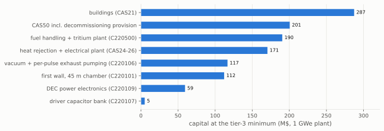
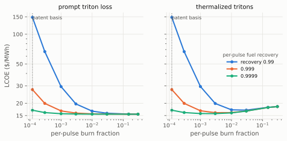

# The techno-economic floor of a Helion-class pulsed FRC power plant

**Abstract.** We price a Helion-class pulsed field-reversed-configuration
(FRC) D-He3 power plant with inductive direct energy conversion using the
`costingfe` bottom-up cost model, and ask how low its levelized cost of
electricity (LCOE) can be pushed while remaining internally consistent,
against the developer's public 10 \$/MWh ambition. Optimism is
disciplined three ways: every input is placed on an evidence ladder
(records, labelled extrapolations, labelled speculation); four physics
couplings are enforced on every quoted point;
and the operating point at each evidence level is found by a constrained
design-space search rather than asserted. The coherent floor is
17.0 \$/MWh at 1 GWe and 13.6 \$/MWh at 3 GWe on full speculation;
the record-supported rung sits at about 191 \$/MWh, above the
vendor's own implied point, because the fuel cycle's recovery claim has
no record and its reversion outweighs every finance record; defensible
extrapolation supports about 40 \$/MWh.
The \$10/MWh target is not reached by any coherent stack, including He-3
at zero price (11.0 \$/MWh at 3 GWe). The floor is carried by site
and support infrastructure (buildings, heat rejection, staffing,
decommissioning) and by the tritium fuel cycle, not by the capacitor
driver; the machine has no turbine island at all. The
fuel cycle is anchored to the vendor's own patent (US 2017/0011811),
which publishes an operating point (n_D = 0.75e22 m^-3, 70 keV) and
specifies tritium removal between pulses: per-pulse burnup is 1.2e-4
for deuterium and 4.1e-4 for He-3 (Bosch-Hale reactivities at a
sub-millisecond dwell), the in-pulse tritium burn is under 1%, and the
store-and-decay He-3 self-supply idealization (dhe3_f_T = 0) holds.
The price of that coherence is the fuel cycle itself: fuel transits the
exhaust loop of order 1e3-1e4 times before burning, so per-pulse
isotope separation at the repetition rate and per-pass fuel recovery of
0.9999 are the load-bearing engineering claims, and per-pulse exhaust
pumping becomes a first-order account (79 M\$ at the floor). The
recovery is graded, not assumed: the JET-ILW retention record supports
three nines (tier 1), the patent-implied fourth nine enters as a
labelled extrapolation (tier 2), and it ties capacitor life as the
largest single lever under the extrapolation-tier minimum
(+39.8 \$/MWh if reverted). A
second finding is a recovery-accounting gap: the plasma-thermal share
of the driver energy, fixed by the FRC equilibrium at 0.30-0.71 of the
delivered energy, can only return through the expansion channel, worth
+1.8 to +4.2 \$/MWh at the extrapolation-tier minimum. A second
finding is a recovery-accounting gap: the plasma-thermal share of the
driver energy, fixed by the FRC equilibrium at 0.30-0.71 of the
delivered energy, can only return through the expansion channel, worth
+1.8 to +4.2 \$/MWh at the extrapolation-tier minimum. All numbers are
reproducible from configuration files and scripts pinned by regression
tests (see Reproducibility).

## 1. Introduction

Helion Energy is developing a pulsed fusion power plant based on the
merging and magnetic compression of two field-reversed-configuration
plasmoids, burning deuterium and helium-3, with the fusion energy
recovered inductively through the compression circuit rather than
through a thermal cycle. The company occupies a singular position in
the private fusion landscape: it has signed the industry's first utility
power purchase agreement (50 MWe, with Microsoft), announced a 500 MW
facility with Nucor, raised capital at a scale that implies investor
belief in aggressive cost targets, and stated a long-run ambition of
electricity at 1 cent/kWh. That number, \$10/MWh, is several times below
the levelized cost of any thermal power plant ever built, and roughly at
the floor of utility-scale photovoltaics on the world's best sites. A
down-select exercise that takes confinement concepts seriously as future
products has to engage with the claim rather than dismiss it: if a
pulsed inductive machine can genuinely reach that range, it dominates
the field; if it cannot, the reasons say a great deal about where the
concept's real economics live.

This paper asks the floor question directly: pushed to the physically
coherent limit of optimism, what is the minimum LCOE of a Helion-class
plant, and what would have to be true, physically, technologically, and
financially, for each successive rung of cheapness to be real? The
framing matters. A single-point cost estimate of a speculative machine
is an argument about a designer's taste. A floor study, by contrast,
makes optimism itself the object of analysis: every optimistic input is
sourced, graded, and coupled to its physical consequences, so the result
is not one number but a ladder of numbers, each labelled with the
evidence it stands on.

Three disciplines keep the ladder honest. First, an **evidence-tier
ladder**: tier 1
admits only citable records and published bounds; tier 2 admits labelled
extrapolations from stated roadmaps or physical arguments; tier 3 admits
labelled speculation, kept but never laundered into a lower tier.
Second, **enforced coherence**: four physics couplings are checked
programmatically on every quoted
point, so that a fuel credit cannot be claimed without its radiation and
tritium consequences, a recovery efficiency cannot be double-booked, and
a shot cannot be costed in a chamber it would melt. Third, **design
optimization under the constraints**: the machine at each evidence level
is the argmin of a scan over chamber geometry, wall class, shot yield,
and burn mix, so the quoted minima are properties of the design space,
not of an asserted operating point.

The headline results are stated in Section 4 and developed afterwards.
Beyond the numbers, the study's contribution is structural: it locates
the load-bearing subsystem of the concept in the tritium fuel cycle
(Section 5) and in the recovery physics of the driver energy
(Section 6), identifies the small set of unmeasured plasma properties
that carry order-10 \$/MWh each, and specifies the measurement protocol
on the developer's own next machine that would resolve them. Everything
here is reproducible: the tier stacks are YAML configuration files, each
figure is produced by a named script, and seventeen regression tests pin
the ladder to a fixed revision of the cost model (see Reproducibility).

## 2. Machine basis

The machine follows Helion's published architecture at face value
(Helion Energy technology and FAQ pages; Kirtley and Milroy 2023). Two
FRC plasmoids are formed by theta-pinch field reversal in opposed
formation sections, accelerated electromagnetically, and merged in a
central compression section, where the collision converts their directed
kinetic energy into ion heat; a subsequent magnetic compression performs
adiabatic work to reach burn conditions. There is no auxiliary heating
system of any kind: the pulsed-power driver is also the heater. After
the burn, the plasma expands against the field, returning driver energy
and charged fusion energy to the coil circuit as PdV work; radiated
power, undirected charged power, and neutrons are not converted
(eta_th = 0 in the machine basis; a bottoming-cycle add-back is carried
in reconciliation). The chamber is a cylinder with copper pulsed coils
whose bore sits 0.10 m behind the first wall; there is no breeding
blanket and no manufactured target (the plasmoid is formed in situ).

The design-basis point takes the driver energy from the sourced Polaris
capacitor bank (50 MJ per pulse) and back-derives the per-shot yield
(101.4 MJ) from the 50 MWe power purchase agreement at 1 Hz, requiring
model consistency with the concept's own conversion parameters rather
than any disclosed measurement. A 1 GWe plant is built as an integer
number of Helion-class modules, with the repetition rate and module
count solved jointly from the net-power target under a rep-rate ceiling.

The fuel cycle is Helion's stated one (US patent 2017/0011811). Running deuterium-rich
(dd_frac = 0.85 at the extrapolation tier and above), half the D-D
reactions breed tritium. None of it is recycled into the burn
(dhe3_f_T = 0 in the basis): the exhaust is pumped, isotope-separated,
and the tritium is stored on getter beds to decay (12.3 yr half-life)
into the He-3 the plant burns, alongside the prompt He-3 from the other
D-D branch, which re-enters the fuel loop with a cumulative recycle
fusion probability set by the per-shot burn fraction and the exhaust
recovery efficiency. The plant therefore has no lithium anywhere; its
tritium plant is an exhaust-processing and storage plant.

## 3. Method

**Cost model.** `costingfe` is a bottom-up, account-structured
(CAS-coded) fusion costing framework. At the pinned commit it prices
linear pulsed concepts as cylinders with the first-wall heat flux
audited against the declared wall class (panel or divertor-grade
surfaces at their respective unit costs and flux limits); pulsed wall
load counts undirected ash, radiation, and conversion waste; the primary
coolant account scales on thermal power; the pulsed driver is priced per
joule of stored energy; the inductive-conversion account carries
circuit-derived markups sized for the energy the physics path actually
returns; and scheduled replacement at the capacitor shot life covers the
full shot-cycled recovery chain (driver bank, recovery store, switch
stack) with a loud warning whenever the chain does not outlive the
plant.

**Evidence ladder.** Tier 1 (records): financing at 4.25% from a
sovereign-backed generation precedent (Apostoleris et al. 2021), 2.5-year construction (Siemens Energy CCGT block precedent), 8%
indirects (US DOE/NETL QGESS), availability 0.95 (US DOE geothermal
fleet data, derated for bank-swap outages), and per-pulse fuel
recovery reverted from the vendor-implied 0.9999 to 0.999, the value
the JET-ILW retention record supports (Brezinsek et al. 2013). Tier 2 (labelled
extrapolations): capacitor life 1e9 shots (the Pacific Fusion AMPS
derating target; Langtry et al. 2025), recovery composite 0.693 with
f_pdv held at the radial-only bound 0.77 (Section 6), 3 Hz on a
purchased divertor-class wall, the D-rich burn mix with its tritium
plant, and fuel recovery 0.9999 (the patent-implied fourth nine). Tier 3 (labelled
speculation): 10 Hz, composite 0.90 (the theory optimum with zero
margin), capacitor capital at 0.1 \$/J, shot life 1e10, He-3 at
0.5 M\$/kg, 80-year plant life. Every entry carries a source and grade
in the evidence ledger (`docs/ledger.md`); no tier-2 entry is a
measured record.

**Coherence constraints.** Four couplings are enforced on every quoted
point: (1) the radiated fraction is a function of the burn mix through a
bremsstrahlung floor (f_rad = 0.28 at dd_frac 0.85, not the lean-mix
0.05); (2) recovery efficiency is capped as the composite
eta_dec x f_pdv (0.80 at tier 2, 0.90 at tier 3), because the only
published figure speaks to the product; (3) the wall must survive both
its steady flux (within the purchased wall class) and its per-shot flash
energy (under the tungsten millisecond-melt bound); (4) a D-rich mix
carries its tritium-plant consequences, priced as a fuel-handling adder
of 50 M\$ fixed plus a throughput-scaled balance anchored at 200 M\$ for
the tier-2 reference machine. Two further audits, developed in
Sections 5 and 6, close the fuel cycle and the driver-energy accounting.

**Design search and reconciliation.** At each evidence level the
operating point is the argmin of a scan over shot yield (tier 3 only;
tier 2 keeps the cited shot), chamber length and radius, wall class, and
burn mix, discarding any design that violates a constraint.
Reconciliation then brackets each minimum with the model gaps it cannot
price internally (HVDC-class switch duty, the tritium-plant band, the
driver-thermalization derate) and its conservatisms (no thermal
bottoming), yielding an honest band rather than a point.

## 4. Results: the ladder, the minima, and what carries the floor

| rung | 1 GWe (\$/MWh) | 3 GWe (\$/MWh) | contents |
|---|---|---|---|
| design baseline | 142.6 | 137.9 | Helion's implied point: 50 MJ driver, 101.4 MJ yield, 1 Hz, D-rich mix at its bremsstrahlung floor |
| tier 1: records | 191.4 | 188.4 | finance (4.25%), 2.5 yr construction, 8% indirects, availability 0.95, fuel recovery reverted to the JET-class 0.999 |
| tier 2: extrapolations | 45.5 | 42.2 | cap life 1e9, composite 0.693 (radial-only recovery), 3 Hz on a divertor-class wall, D-rich mix with tritium plant, fuel recovery 0.9999 (patent-implied) |
| tier 3: speculation | 17.9 | 14.4 | 10 Hz, composite 0.90, cap \$/J 0.1, cap life 1e10, He-3 at 0.5 M\$/kg, 80 yr |

Design optimization improves the last two rungs to **40.3 \$/MWh** (tier 2,
1 GWe: the cited 101.4 MJ shot in nine 20 m x 0.5 m panel-wall modules
at 2.9 Hz) and **17.0 / 13.6 \$/MWh** (tier 3, 1 / 3 GWe: 200-750 MJ shots in
45 m x 1.0 m chambers, a broad plateau in yield). Reconciliation bands:
tier 2 within 30.8-48.4 \$/MWh, tier 3 within 15.7-18.3 \$/MWh at
1 GWe.

The record rung sits above the design baseline: reverting the vendor's
per-pulse fuel recovery to the JET-class record (0.999) costs
+79 \$/MWh on the lean mix's purchased He-3, more than every finance
record saves. On evidence alone, the vendor's fuel cycle is uneconomic;
the descent begins only when the recovery extrapolation is granted at
tier 2. The baseline and record rungs are also dominated by scheduled
replacement: the entire shot-cycled recovery chain is replaced on the
capacitor-life schedule, about eight times over plant life at the
1e8-shot record life.

*Figure 1: The evidence ladder at 1 and 3 GWe. The tier-1 rung sits
above the design baseline because reverting the vendor's per-pulse fuel
recovery to the JET-class record outweighs every finance record; the
design-optimized minima are shown beneath their rungs.*

One-at-a-time reversion from the tier-2 minimum ranks the levers:

| knob reverted | LCOE (\$/MWh) | delta (\$/MWh) |
|---|---|---|
| fuel_recovery -> 0.999 (JET-class record) | 84.8 | +44.5 |
| cap_shot_lifetime -> 1e8 | 82.2 | +42.0 |
| dhe3_dd_frac -> 0.314 (with its f_rad) | 56.5 | +16.2 |
| max_f_rep -> 1 Hz | 52.9 | +12.7 |
| eta_dec -> 0.85 | 44.8 | +4.6 |
| f_rad -> 0.163 (incoherent) | 36.4 | -3.8 |
| eta_pin -> 0.95 | 42.5 | +2.2 |
| f_pdv -> 0.80 (baseline exceeds the radial-only bound) | 39.5 | -0.8 |

Two levers co-dominate at +42 to +45 \$/MWh each: the per-pulse fuel
recovery (an extrapolated nine beyond the JET retention record) and the
capacitor cycle life (a published derating target); the burn-mix
package and the rep rate follow; reverting f_pdv to the baseline 0.80
is mildly favorable, the signature of an anti-record;
see Figure 2. the conversion efficiencies,
once capped as a composite, are worth little at the margin (an
incoherent double-booking of eta_dec = 0.97 with f_pdv = 0.95 would
claim tens of \$/MWh and is excluded by construction).

*Figure 2: One-at-a-time reversion of each tier-2 entry to its tier-1
value, from the 40.3 \$/MWh design-optimized minimum. Red bars are
favorable reversions, the signature of anti-record entries.*

At the tier-3 minimum the capacitor-driver narrative is spent (the bank
is 5 M\$ of a 690 M\$ reactor account) and the floor is carried by
site and support infrastructure and by the fuel cycle (there is no
turbine island; the heat-rejection and electrical-plant accounts below
are not a steam cycle):

| item | M\$ | \$/MWh (approx) |
|---|---|---|
| buildings (CAS21) | 287 | 1.6 |
| CAS50, of which decommissioning provision 140 | 199 | 1.1 |
| fuel handling + tritium plant (C220500) | 190 | 1.1 |
| heat rejection + electrical plant (CAS24-26) | 171 | 0.9 |
| vacuum and exhaust (C220106), of which per-pulse pumping 79 | 112 | 0.6 |
| first wall of the 45 m chamber (C220101) | 109 | 0.6 |
| DEC power electronics (C220109) | 59 | 0.3 |
| O&M (CAS70) | 54/yr | 6.4 |
| annualized capital, all-in | | about 7.5 |

*Figure 3: Capital accounts carrying the tier-3 minimum. The driver
bank, the concept's narrative centerpiece, is the smallest bar; site
infrastructure and the fuel cycle dominate.*

## 5. The tritium fuel cycle is the load-bearing subsystem

### 5.1 Rates and inventory

At the tier-3 minimum the single module runs 7.8e20 D-D and 4.5e20
D-He3 reactions per second; only 1.4e20/s of the D-He3 burns are fed by
purchased He-3, the rest by recycled bred He-3 (per-pass survival
0.80). The module breeds tritium at half the D-D rate: 0.33 mg per
shot, 59 kg/yr. The tier-2 reference machine carries 228 MW of plant
neutron power and breeds about 87 kg/yr. Store-for-decay fixes the
equilibrium inventory at production rate times the 17.8 yr mean life:
about 1.55 tonnes of tritium, which is 1.5e10 Ci, about 500 kW of
continuous decay heat, roughly 390x ITER's site authorization and 55x
the world's civilian tritium stock. The
inventory is intrinsic to He-3 self-supply at this scale; shipping it to
a central fuel facility relocates it (and can hold the reactor site near
ITER-class inventory with weekly pickups) but cannot shrink it. This is
why the ledger refuses the "near-zero licensing" claim alongside the
fuel credit, holds O&M at its baseline, and treats the 200 M\$
tritium-plant allowance as more likely low than high.

### 5.2 The burnup contradiction

The store-and-decay idealization (dhe3_f_T = 0: no bred triton burns
in-plasma) is not a free choice; it is a claim about pulse kinetics. A
triton born mid-pulse sits in a deuterium-rich plasma at fusion
temperature for the remaining dwell, and D-T reactivity is 14-43x D-D
at 70-20 keV (Bosch and Hale 1992). The per-shot deuterium burnup pins the integrated
exposure x_DD = -ln(1 - f_D) = n_D <sigma v>_DD tau without requiring
density or dwell separately, and averaging triton births over the pulse
gives the in-pulse tritium burn probability

    f_T = 1 - (1 - e^-x)/x,  x = (sv_DT / sv_DD) x_DD.

The study's configuration assumes burn_fraction = 0.15 (an unsourced
magneto-inertial-literature midpoint, adopted because the vendor
publishes gain, not burnup). At that burnup, f_T = 78-93% across
70-20 keV if tritons thermalize and remain confined: the two
assumptions, taken together, fail by an order of magnitude. The
contradiction is internal to the study's basis, not an inference about
the vendor's machine; what it establishes is that the real operating
point must occupy one of three coherent regimes, each priced below,
none free:

- **Low burnup** (f_D at or below about 7e-4 for f_T under 1%): the
  unburned-fuel recycle loss multiplies the fuel account 15x at 99%
  exhaust recovery (2.4x at 99.9%), the bred-He-3 recycle credit
  collapses, and the pumped throughput grows two orders.
- **Prompt triton loss**: the 1.01 MeV triton's centimeter-scale
  gyroradius in the compressed plasmoid may exceed the fast-ion
  confinement of a small-s FRC, ejecting it before it thermalizes. This
  is the only exit preserving both high burnup and the store, it costs
  about 1 MeV per breeding event to the undirected channel, and it is
  measurable on Polaris.
- **Accept the burn** (dhe3_f_T = 0.78): the tier-2 rung rises to
  58.1 \$/MWh and the tier-3 minimum to 20.0 \$/MWh, plant neutron
  power rises about 5x with a dominant 14.1 MeV component, and the
  decay store shrinks to 0.2-0.3 t; these are floors, because the base
  wall audit checks surface heat only.

The vendor's fuel-cycle patent (US 2017/0011811) settles which regime
the design intends, and corrects the study's assumption in the process.
It publishes an operating table (n_D = 0.75e22 m^-3, T = 70 keV,
tau = 0.157 s without tritium removal and 0.103 s with it) and states
that tritium "may be removed between each pulse ... prior to undesired
D-T reactions taking place". Running the closure on those numbers:
per confinement period the D burn is 2.5-3.8% and a thermalized triton
riding it would burn 28-38%, the patent's own motivation for
inter-pulse removal; per sub-millisecond pulse at the patent density
the burnup is 1.2-2.5e-4 and the in-pulse tritium burn 0.2-0.3%,
comfortably validating dhe3_f_T = 0. The study's burn_fraction = 0.15
is therefore a cumulative single-pass figure, accumulated over of order
a thousand pulses of fuel residence, misapplied as per-pulse exposure.
The correction moves the machine to the far left of the burnup axis
(Section 5.3), where the costs relocate rather than vanish: with
per-pulse reprocessing, the unburned-fuel multiplier is 83x at
per-pass recovery 0.99, 9.2x at 0.999, and 1.8x at 0.9999, so
four-nines per-pulse fuel recovery and hertz-rate isotope separation
are the load-bearing engineering claims of the published fuel cycle,
and the tritium plant is their price. These are the model's basis:
burn_fraction = 1.2e-4 and burn_fraction_he3 = 4.1e-4 per pulse (He-3
burns 3.3x faster per pass, so the expensive species recycles at 0.80
survival while deuterium leaks), with species-resolved recycle losses
in the fuel account. The recovery itself is laddered: the vendor-implied
0.9999 stays in the design basis, tier 1 reverts it to the JET-ILW
retention record (0.999), and tier 2 re-grants the fourth nine as a
labelled extrapolation.

### 5.3 The burnup axis

Both species' per-pass burn fractions derive from the same n tau, so
the axis is swept coherently: burn_fraction_he3 scales with
burn_fraction at the fixed 70 keV reactivity ratio (3.3x). Figure 4
shows the result under both triton fates at exhaust recovery 0.99,
0.999, and 0.9999. At the patent-density basis the recovery nines
carry everything: 17.0 \$/MWh at fr = 0.9999, 27.5 at 0.999, 148 at
0.99 (the fourth nine is worth 10 \$/MWh, the third 120). Moving
right along the axis, i.e. toward higher compression density, the
recovery requirement relaxes: above per-pulse burnup of about 3e-3
the three- and four-nines curves converge near 15.5-16.0 \$/MWh on
the prompt-loss branch, and the axis minimum (15.5, at burnup 1e-2 to
3e-1) sits about 1.5 \$/MWh below the basis. The thermalized branch
turns up past burnup 0.01 as the tritium burn grows (13-90%), so the
triton-fate question reopens exactly where the recovery question
closes. Per-pulse exhaust pumping is priced across the axis and peaks
at the basis (79 M\$ per module at the floor: 8300 pumped particles
per reaction).

*Figure 4: LCOE at the tier-3 minimum machine across the per-pulse
burnup axis, both species scaled together, under the two triton fates
and three exhaust-recovery grades. The patent-density basis (dotted)
is the hardest point for fuel recovery; the recovery grades converge
above burnup of about 3e-3, where the thermalized branch begins to
pay for its tritium burn instead.*

### 5.4 Neutron damage, the unshieldable throat, and the consumable core

The base model cannot see neutron damage for this concept (its core
lifetime knob is inert), so the scan reprices it: replacement of the
exposed package is levelized from the 14-MeV-equivalent neutron wall
load (10 dpa per MW yr/m^2 in Fe-based structure; the 2.45 MeV D-D flux
folded at 0.4) at tolerances of 20 dpa (the demonstrated RAFM database
edge) and 50 dpa (the DEMO-class design target). The event carries both
the wall and the close-coupled coils (109 + 17 M\$ at the tier-3
minimum), since nothing 0.10 m behind the wall outlives it. At the
patent basis the spectrum is pure 2.45 MeV D-D at a 14-MeV-equivalent
load of 0.20 MW/m^2, and the replacement adder is modest
(+0.3-1.2 \$/MWh at 50-20 dpa). The damage story reopens only in the
high-burnup counterfactuals: if the reactor-point density pushes
per-pulse burnup toward the 0.1 regime with thermalized tritons, the
all-in gap between prompt-loss and thermalized reaches 8-17 \$/MWh,
and at the tier-2 rung, whose wall is divertor-class at 2.5 M\$/m^2,
thermalized high-burnup replacement is prohibitive (+53 to
+161 \$/MWh). Keeping the tritium out of the burn is therefore free
insurance at the basis and worth double digits off it.

Shielding cannot buy the machine out of this, because a pulsed
inductive plant pays per pulse for every cubic meter of flux volume
between coil and plasma: W = (B^2/2mu0) x annulus volume, recovered
only at the composite efficiency. The 50 MJ driver at 10 T implies
about 1.2 m^3 of compression-section flux volume; a 0.4 m shield under
the compression coil multiplies the swept annulus about 5x, growing the
store to roughly 270 MJ/pulse and dissipating about 20 MJ/pulse at
composite 0.90, order 100 MW of recirculating loss at the tier-3 rep
rate, and more than the module's output at the tier-2 composite. Eddy
screening is the lesser problem (steel's skin depth at millisecond rise
times is about 16 mm, so structure must be laminated; molten salt at
about 200 S/m is magnetically transparent); the magnetized volume
itself is the irreducible cost. A shield is affordable only around the
low-field expansion chamber. The resulting neutron architecture is
sacrificial ceramic-insulated throat coils on the wall schedule plus a
shielded expander, and the burn is localized near the throat, so the
uniform-cylinder audit understates the local load; a localized audit
would roughly double the damage adders.

The replacement schedule has a structural threshold. The exposed
package (wall, coils, vessel shell) is 159 of about 373 M\$ of
per-module reactor hardware; replacement of the wall-and-coil event
(126 M\$) outspends the module's own capital service when its interval
falls below about 8 years. At the patent basis (D-D spectrum,
0.20 MW/m^2 equivalent) the interval is 10-26 years at 20-50 dpa: a
capital asset, though near the line at the RAFM database edge. The
consumable-core regime (1-3 year intervals, half the module's value
swapped near-annually) belongs to the high-burnup thermalized
counterfactual. In
that regime the coherent design is a swappable irradiated cartridge
with hot-spare bays (a single-module plant cannot hold availability
0.95 through annual month-scale swaps; a multi-module park can, at
about one spare module of extra capital), a refurbishment line, and a
few hundred tonnes per year of activated steel and copper that neither
the decommissioning provision nor the remote-handling account is scoped
for. Consumable-core economics are marginal-manufacturing economics,
which is where a fleet-learning term (absent from the model) would
finally bind on something real.

### 5.5 The He-3 balance and the observed market

The fuel account charges every primary D-He3 event as purchased He-3
(1 - dd_frac per event) and credits prompt bred He-3 through its
species-resolved cumulative recycle fusion probability (0.80 at the
per-pulse basis: He-3 burns out of the loop 3.3x faster per pass than
it leaks). What it never credits is the decay store's He-3 return,
0.42 atoms per primary event, equal to the prompt branch. Without it
the machine imports about 45 kg/yr of He-3; crediting it flips the
plant to a net exporter. The question is not academic,
because the only observed He-3 transactions (2024-2026: spot near
\$2,500/L per the Edelgas Group; Interlune's DOE Isotope Program and
Maybell Quantum agreements priced "at today's commercial market
price"; TAE's unpriced Black Moon lunar supply option) sit at
19-22 M\$/kg on
gram-to-kilogram volumes, 10x above the study's baseline price and 40x
above its tier-3 entry, with every new entrant building toward the high
price. At the observed spot the tier-2 minimum reads 151 \$/MWh at the
D-rich mix and 385 \$/MWh lean under the model's accounting, against
28.0 \$/MWh at the full self-supply limit; the distance between those two numbers is
the value of the crediting decision, coupled to Section 5.2 because the
decay return exists only if the tritium survives the pulse. A
by-product observation: at these prices a kilogram of He-3 burned at
the floor produces about \$2M of electricity but sells for \$19-22M, so
an early breeding plant maximizes value selling He-3 into the thin
cryogenics and quantum market until fleet supply floods it.

## 6. Recovery physics: what the circuit actually gets back

The composite cap (constraint 2) already prevents the double-booking of
conversion efficiencies. Two further effects sit beneath it.

**Driver thermalization.** The machine has no auxiliary heating:
merging shock and compression work are the heating, all driver-fed. The
model's conversion path nonetheless recovers the entire delivered
driver energy at the flat inductive efficiency, as if it all remained
in field form. The plasma-thermal share chi can only return through the
same expansion channel as the fusion heat, at f_pdv, on an adiabat
already degraded by the deliberately irreversible merging. chi is not a
free parameter: at peak compression, radial equilibrium and the FRC
average-beta theorem (<beta> = 1 - x_s^2/2; Tuszewski 1988) fix it as
a function of the separatrix-to-coil radius ratio alone,

    chi(x_s) = 1.5 <beta> x_s^2 / (1.5 <beta> x_s^2 + 1 - x_s^2),

giving chi = 0.30 / 0.52 / 0.71 at x_s = 0.5 / 0.7 / 0.85. Fat FRCs
are high-chi machines: good confinement physics pushes the derate up.
The extra recirculating loss eta_dec chi (1 - f_pdv) p_driver is worth
+3.3/+5.7/+7.8 \$/MWh at the tier-2 minimum across that x_s span (the
Q of order 2 machine circulates 1310 MW of driver power, and the
radial-only f_pdv widens the uncaptured channel),
+0.1 \$/MWh at the tier-3 minimum, and order +10 \$/MWh at the low-Q
baseline rung. It is carried
as a reconciliation adder pending a model-level treatment.

**The expansion-ratio bound.** Adiabatic expansion caps the recoverable
fraction of plasma energy at 1 - (V_i/V_f)^(2/3), making f_pdv a
chamber-coupled quantity: the tier-2 minimum's 20 m chamber supports
about 0.82 against its claimed 0.85, and the tier-3 45 m chamber about
0.96 against 0.947. Both sit at the geometric edge: the large chamber
buys expansion ratio, not merely wall area, and claimed recovery
fractions cannot be improved without more chamber.

**The parallel channel.** The expansion work is not all radial, and the
components couple to the circuit differently. Radial expansion
compresses flux against the main coil: the cleanly captured channel.
Axial elongation pushes the diamagnetic plasmoid against the end-field
gradient, changing flux linkage through the end and adjacent coils:
capturable only if those circuits are switched for recovery during the
stroke, a design choice. Parallel particle streaming along open field
lines (the exhaust) couples to nothing and lands in the undirected
residual. FRC adiabatic scalings (r_s proportional to B^-2/5, length
to B^-1/5; Tuszewski 1988, Kirtley and Milroy 2023) put the axial
share of the boundary work near 1/5, and a self-similar cylinder
bounds it at 1/3, so a machine that recovers only the radial channel
caps f_pdv at roughly 0.67-0.8 of the adiabatic bound, about 0.77 at
the tier-3 chamber. The tier-2 to tier-3 recovery step (composite
0.693 to 0.90) is therefore equivalent to claiming capture of the
axial expansion channel; the claim is priced, and it is measurable on
the same shot sequence below.

**Measurement protocol.** A three-shot sequence on Polaris separates
the whole chain: a vacuum shot measures eta_dec alone; a plasma no-burn
shot returns eta_dec[(1 - chi) + chi f_pdv], so its deficit against
vacuum measures chi(1 - f_pdv); a burning shot adds the fusion
composite. This single protocol prices the composite cap, the
thermalization share, and (through the wall budget) the rep-rate
ceiling; published excluded-flux radii pin chi per shot in the interim.

## 7. Plant architecture: modules, parks, and the small-plant penalty

Two controlled sweeps at the tier-3 stack (constant gain, constant wall
loading, driver and chamber scaled with module power) separate module
count from plant size. **Module count at fixed plant size is nearly
free**: delivering 1 GWe from thirteen 80 MWe modules instead of one
large module costs +2.1 \$/MWh (17.0 to 19.1 \$/MWh), because buildings, supplementary
capital, and balance of plant price plant totals; the only modularity
tax is per-module fixed items, biting below about 100 MWe. **Standalone
plant size is expensive**:

| plant | LCOE (\$/MWh) | \$/kW | dominant penalties |
|---|---|---|---|
| 1 GWe | 17.0 | 1475 | - |
| 250 MWe | 27.3 | 2285 | fixed site buildings, staffing^0.5 |
| 50 MWe | 64.1 | 6464 | O&M 27 \$/MWh (staffing law), 141 M\$ of buildings, tritium-plant fixed core |

*Figure 5: The same physics sold two ways at the full speculative
stack. Module size in a 1 GWe park is nearly free; standalone plant
size is expensive, and the 50 MWe standalone unit costs 3.4x the park
floor.*

The penalty decomposes into three mechanisms: about 138 M\$ of fixed
site buildings calibrated on fission-class analogs (an analog-class
question for a factory-shipped unit on an industrial pad); the P^0.5
staffing law (INL sodium-fast-reactor staffing basis; no documented
record yet supports remote fleet operation of a fusion-class plant, so
it stays); and the absence of any
fleet-learning term on equipment, the one mechanism that could make
mass-produced small units positively cheaper, which must be anchored
beyond the fleet size the NOAK constants already assume or it double
counts. The in-model conclusion is unambiguous: this concept's
economics live in power parks, many modules sharing one site, one
staff, one balance of plant. The physics is nearly indifferent to
module size above 100 MWe, so a 50 MWe module is a manufacturing
choice the model neither rewards nor punishes at park scale; sold as a
standalone distributed plant it is a 64 \$/MWh machine on the full
speculative stack.

## 8. What would have to be true to reach \$10/MWh

On top of the full tier-3 stack at 3 GWe (13.6 \$/MWh), in decreasing order of
plausibility:

- **He-3 at effectively zero cost** (11.0 \$/MWh): a mature breeding
  economy or
  an external supply two orders below the observed market. Even this
  does not break 10 \$/MWh, because the tritium plant scales with the breeding
  throughput that funds the credit.
- **Gas-class site and decommissioning analogs** (about 1-1.5 \$/MWh):
  defensible only for the He-3-lean machine; the D-rich machine's
  tonne-class tritium inventory argues the other way.
- **A real fleet-learning term** on equipment, anchored beyond the NOAK
  reference fleet: the only mechanism that rewards the mass-produced
  small-unit strategy at all.

None of these is in the evidence base at any tier. Within what the
study can defend: records alone price the concept at about 191 \$/MWh (above its own
design baseline), defensible extrapolation supports about 40 \$/MWh,
and coherent speculation bottoms at 17 \$/MWh (1 GWe) / 14 \$/MWh
(3 GWe).

## 9. Caveats that survive into the headline

- No tier-2 entry is a measured record: the two largest levers (cap
  life, rep rate) and the burn mix are respectively a published target,
  a roadmap paraphrase, and a sweep endpoint.
- The tier-3 stack is jointly, not just individually, heroic: 0.1 \$/J
  capacitors and 1e10-shot life together contradict the derating
  physics that connects capacitor cost to life; the composite sits at
  the theory optimum with zero margin; three-nines exhaust recovery
  becomes load-bearing at low burnup.
- The headline floor exists only at the high-burnup, prompt-triton-loss
  corner of the fuel cycle (Section 5), and the damage adders that
  price the alternative are more likely low than high (fission-spectrum
  dpa data, an order more helium per dpa at 14 MeV, uniform-cylinder
  averaging over a localized burn).
- Model gaps priced in the bands but excluded from the headline:
  HVDC-class switch duty, tritium-plant scope, driver thermalization.
  The main conservatism cuts the other way (no thermal bottoming in the
  basis, worth -5.5 \$/MWh at the tier-2 minimum).

## 10. Relation to the Borealis mirror study

Same framework, same evidence discipline, one ledger harmonized against
the other (knob-by-knob divergence table in `docs/ledger.md`; every
divergence carries a stated physics or technology reason). At the
speculation tier the mirror is 2.5 \$/MWh cheaper at 3 GWe (Borealis
11.1 \$/MWh, this study 13.6 \$/MWh). At the extrapolation tier it is
materially cheaper (16.9 against 40.3 \$/MWh), chiefly because it needs no
capacitor-life breakthrough, no tritium plant, and no rep-rate roadmap:
its levers already sit in the evidence tiers. On the down-select axis
"how much unpurchasable physics does the cheap number require", the
mirror requires less; on the axis "how large is the speculative
upside", the two are comparable.

## 11. Conclusions and measurement priorities

A Helion-class pulsed FRC plant, priced bottom-up with enforced physics
coherence, bottoms out at about 17 \$/MWh at 1 GWe and 13.6 \$/MWh at 3 GWe on
full speculation; the public \$10/MWh target is not reached by any
internally consistent stack the study can construct. The floor is
carried by site and support infrastructure (buildings, heat
rejection, staffing, decommissioning) and by the tritium fuel cycle,
not by the capacitor driver, and the concept's economics require power
parks rather than distributed small plants. The cheap numbers rest on a
small set of unmeasured properties, ranked here by the \$/MWh they
gate:

1. **Capacitor cost-at-life** (tens of \$/MWh): a sourced curve
   replacing the single derating target, resolving the joint optimism
   of 0.1 \$/J with 1e10-shot life.
2. **Per-pulse burnup, extraction, and fuel recovery** (5-17 \$/MWh):
   the vendor's patent resolves the study's assumption error in favor of
   low per-pulse burnup with inter-pulse tritium removal, but a patent
   is design intent, not a measurement; the reactor-point compression
   density, the demonstrated per-pulse separation rate, and the
   per-pass fuel recovery (four nines required at the published
   operating point) fix the neutron spectrum, the wall-replacement
   schedule, and the fuel-cycle cost between them.
3. **The recovery chain** (order 5 \$/MWh at tier 2): the Polaris
   vacuum / no-burn / burn shot triplet separates the circuit
   efficiency, the thermalization share chi(1 - f_pdv), and the
   fusion-inclusive composite in one campaign.
4. **A duty-cycle basis for multi-Hz operation** and **a costed
   tritium-plant scope** for the D-rich cycle (single \$/MWh each, but
   licensing-defining).

The constructive reading for the concept: its floor is real and low by
any thermal-plant standard, its architecture (factory modules, park
deployment, swappable cores) is well matched to the failure modes the
physics imposes, and the measurements that would move its ladder rungs
from speculation to evidence are all available on hardware the
developer is already building.

## Reproducibility

All quantities in this paper are produced by the scripts named in the
text from the configuration files in `config/`, against the `costingfe`
cost model at commit `7042946` (which guarantees the cylinder wall
audit, rep-rate sizing, shot-cycled replacement scope,
physics-consistent recovery-store markup, and per-pulse fuel-cycle
semantics this study relies on). Seventeen regression tests in
`tests/test_study.py` pin every ladder rung, both coherent minima, the
tritium-burn closure, and the chi(x_s) equilibrium anchors, and fail
loudly if the model moves under the study.

## References

- Apostoleris, H., et al. (2021). "The view from the sun: revisiting
  record-low solar PPA prices." Progress in Photovoltaics 29.
- Bosch, H.-S., and Hale, G. M. (1992). "Improved formulas for fusion
  cross-sections and thermal reactivities." Nuclear Fusion 32, 611.
- Brezinsek, S., et al. (2013). "Fuel retention studies with the ITER-
  Like Wall in JET." Nuclear Fusion 53, 083023.
- Helion Energy. Technology and FAQ pages (helionenergy.com/technology,
  /faq); Microsoft power purchase agreement announcement (2023); Nucor
  500 MW facility announcement (2024).
- Helion Energy (Slough, J., et al.). US patent application
  2017/0011811, "Advanced fuel cycle and fusion reactors utilizing the
  same" (the breed-extract-store-decay fuel cycle and its operating
  table).
- Helion Energy. US patent application 2024/0275198 (inductive
  recovery circuit band cited for eta_dec).
- Kirtley, D., and Milroy, R. (2023). "Fundamental scaling of
  adiabatic compression of field reversed configuration thermonuclear
  fusion plasmas." Journal of Fusion Energy 42, 30.
- Langtry, A., et al. (2025). "Affordable, manageable, practical
  Z-pinch driver (AMPS)." arXiv:2504.10680 (capacitor derating and
  shot-life target; MagLIF burn fraction).
- Rubin, T. (2026). costingfe: a bottom-up fusion power plant cost
  model. Repository at commit `7042946`.
- Tuszewski, M. (1988). "Field reversed configurations." Nuclear
  Fusion 28, 2033 (FRC equilibrium, average-beta theorem, adiabatic
  scalings).
- US DOE/NETL. Quality Guidelines for Energy System Studies: EPCM
  indirect-cost basis.
- US DOE Geothermal Technologies Office. Geothermal FAQ (fleet
  availability).
- Edelgas Group (2024). Helium-3 market pricing, as reported in
  SpaceNews and Newsweek coverage of the Interlune agreements (2025);
  Interlune-DOE Isotope Program and Interlune-Maybell Quantum
  agreements (2025); TAE Technologies and Black Moon Energy Corporation
  helium-3 supply option (2026).
- Sethian, J., et al.; Moses, E., et al. (laser-IFE reactor burn
  fractions, cited via the cost model's per-concept appendix).
- Idaho National Laboratory. Advanced-reactor staffing studies (the
  P^0.5 O&M scaling basis).
