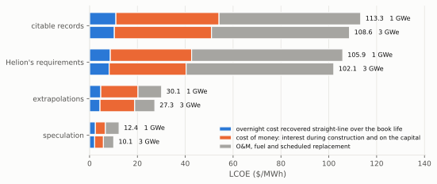
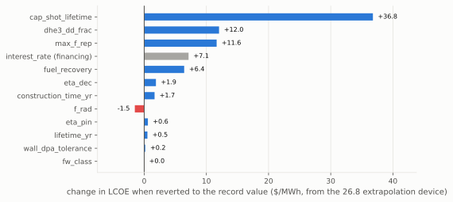
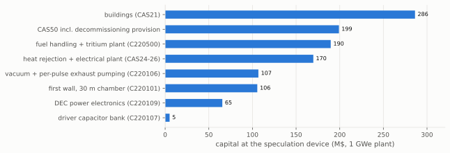
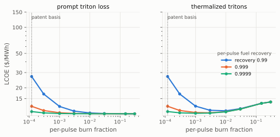
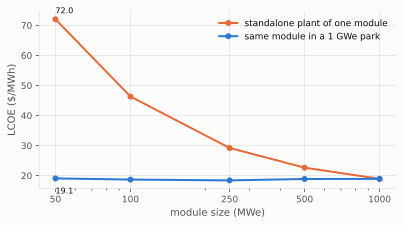

# The techno-economic floor of a Helion-class pulsed inductive fusion power plant

In this work, we investigate how cheap fusion electricity can get if
direct energy conversion is the key technology for harnessing fusion
energy. It is one of six studies, each taking such a thesis to its
physically coherent limit and asking how low the levelized cost of
electricity (LCOE) can be driven.

Direct energy conversion is
attractive because it allows a much higher conversion efficiency from
energy in the plasma to electricity than the limit imposed by the
working temperature of a conventional working fluid. The direct energy
conversion system also replaces the conventional and expensive turbine
island. The best fusion fuel for this purpose is deuterium-helium-3 (D-He3),
whose fusion energy is carried almost entirely by charged particles.
And the best physical mechanism for directly interacting with the plasma
is inductive recovery: a coil-driven magnetic field compresses the
plasma, and the plasma then expands against that field much as the gas
in an engine expands against a piston.
That is what Helion Energy is building, so this work takes Helion's
published design and results as its starting point and builds the
argument on them.

Helion Energy has made a compelling case to its investors, raising
about $1.5B, and has already secured a power purchase agreement with a
customer. Markedly, it states a long-run ambition of electricity at
1 cent/kWh ($10/MWh), and that figure is what the 1cFE residency at
Astera is set on investigating.

Helion realizes inductive recovery in a pulsed linear device:
capacitor-driven coils generate an external axial field, and the plasma
is formed within it as two field-reversed configuration (FRC)
plasmoids. These are accelerated toward each other and merged, the
collision converting their directed kinetic energy into ion heat. The
resulting single hot FRC is then compressed to burn conditions by
raising the external field. An important feature of the FRC is used
here: radial and axial compression are coupled, and raising the
external field does both. The fusion heat released at burn causes an
isobaric expansion. That expansion returns the driver energy and part
of the fusion energy to the capacitor banks through the same coils.
This is a Diesel-type thermodynamic cycle with an Atkinson
over-expansion stroke.

This work is divided into the following parts: we describe Helion's
device and subsystem requirements according to the available published
material. We then price that device with these subsystems held at the
state of the art. That is tier 1 - existing technology and citable
records. Then, we take a step forward and consider tier 2 -
extrapolations, and tier 3 - speculation. Six physics couplings are
enforced on every quoted point, so that a fuel credit cannot be claimed
without its radiation and tritium consequences, a recovery efficiency
cannot be double-booked, and a shot cannot be costed in a chamber it
would melt. For each tier, we perform design optimization over chamber
geometry, wall class, shot yield, and burn mix, so the quoted minima are
properties of the design space, not of an asserted operating point.

This work uses the `1costingfe` bottom-up cost model, which
uses publicly available data and labeled extrapolations. This open
source code is available [here](https://github.com/1cFE/1costingfe),
with detailed documentation
[here](https://files.1cf.energy/1costingfe_paper.pdf).

Records alone price the concept at about 173 $/MWh (218 $/MWh at the
vendor's own configuration), above the vendor's implied point: the fuel
cycle's recovery claim has no record, and its reversion outweighs every
finance record. Defensible extrapolation supports about 41 $/MWh. The
coherent floor, on full speculation, is 16.8 $/MWh at 1 GWe and 13.5
$/MWh at 3 GWe. The $10/MWh target is not reached by any coherent stack,
including He-3 at zero price (10.9 $/MWh at 3 GWe). The floor is carried
by site and support infrastructure (buildings, heat rejection, staffing,
decommissioning) and by the tritium fuel cycle, not by the capacitor
driver; the machine has no turbine island at all.

Section 4 develops the ladder and its minima. Beyond the numbers, this
work's contribution is structural: it locates the load-bearing
subsystem of the concept in the tritium fuel cycle (Section 5) and in
the recovery physics of the driver energy (Section 6), identifies the
small set of unmeasured plasma properties that carry order-10 $/MWh
each, and specifies the measurement protocol on the developer's own
next machine that would resolve them.

The fuel cycle is anchored to the vendor's own patent (US 11,469,003
B2), whose operating table (n_D = 0.75e22 m^-3, 70 keV, and a
pressure-balance field of 22 T, adopted as the compression-field basis
and priced into the coils) specifies tritium removal between pulses. At
that point the per-pulse burnup is 1.2e-4 for deuterium and 4.1e-4 for
He-3 (at a 0.5 ms dwell inside the vendor's sub-millisecond statement)
and the in-pulse tritium burn is under 1%, so the He-3 supply can be
idealized as self-supplied from stored tritium decay, but fuel transits
the exhaust loop of order 1e3-1e4 times before burning. Per-pulse
isotope separation at the repetition rate and per-pass fuel recovery of
0.9999 are therefore the load-bearing engineering claims, and per-pulse
exhaust pumping becomes a first-order account (79 M$ at the floor). That
recovery is graded, not assumed: the JET-ILW retention analogy (an
analog argument, not a per-pass record) supports three nines at tier 1,
the patent-implied fourth nine enters as a labeled extrapolation at tier
2, and its reversion ties capacitor life as the largest single lever
under the extrapolation-tier minimum (+43.9 $/MWh). A lower
reactor-point field is the dominant open risk: burnup falls as B^2, and
a 10 T machine adds 6 $/MWh to the floor, a 5 T machine 32 $/MWh. The
coils are priced along the machine's own expansion adiabat, so chamber
length is active structure whose conductor cost grows as L^(1/3), never
free. The fraction of the expansion work recovered is likewise derived,
not assumed: each design's recovery is capped by its own chamber's
adiabatic expansion ratio times the radial share of the boundary work,
with the axial-channel capture that would lift that share to unity
admitted only at tier 3. A residual accounting gap remains on the
recovery side: the plasma-thermal share of the driver energy, fixed by
the FRC equilibrium at 0.30-0.71 of the delivered energy, can only
return through the expansion channel, worth +3.2 to +7.4 $/MWh at the
extrapolation-tier minimum.

Everything here is reproducible: the tier stacks are YAML configuration
files, each figure is produced by a named script, and eighteen
regression tests pin the ladder to a fixed revision of the cost model
(see Reproducibility).

## 2. Machine basis

The machine follows Helion's published architecture at face value
(Helion Energy technology and FAQ pages; Kirtley and Milroy 2023). Two
FRC plasmoids are formed by theta-pinch field reversal in opposed
formation sections, accelerated electromagnetically, and merged in a
central compression section, where the collision converts their directed
kinetic energy into ion heat; a subsequent magnetic compression performs
adiabatic work to reach burn conditions. There is no auxiliary heating
system of any kind: the pulsed-power driver is also the heater. After
the burn, the plasma expands against the field, returning driver energy
and charged fusion energy to the coil circuit as work; radiated
power, undirected charged power, and neutrons are not converted
(eta_th = 0 in the machine basis; a bottoming-cycle add-back is carried
in reconciliation). The chamber is a cylinder with copper pulsed coils
whose bore sits 0.10 m behind the first wall; there is no breeding
blanket and no manufactured target (the plasmoid is formed in situ).

The design-basis point takes the driver energy from the sourced Polaris
capacitor bank (50 MJ per pulse) and back-derives the per-shot yield
(101.4 MJ) from the 50 MWe power purchase agreement at 1 Hz, requiring
model consistency with the concept's own conversion parameters rather
than any disclosed measurement. A 1 GWe plant is built as an integer
number of Helion-class modules, with the repetition rate and module
count solved jointly from the net-power target under a rep-rate ceiling.

The fuel cycle is Helion's stated one (US 11,469,003 B2). Running deuterium-rich
(dd_frac = 0.85 at the extrapolation tier and above), half the D-D
reactions breed tritium. None of it is recycled into the burn
(dhe3_f_T = 0 in the basis): the exhaust is pumped, isotope-separated,
and the tritium is stored on getter beds to decay (12.3 yr half-life)
into the He-3 the plant burns, alongside the prompt He-3 from the other
D-D branch, which re-enters the fuel loop with a cumulative recycle
fusion probability set by the per-shot burn fraction and the exhaust
recovery efficiency. The plant therefore has no lithium anywhere; its
tritium plant is an exhaust-processing and storage plant.

## 3. Method

**Cost model.** `1costingfe` is a bottom-up, account-structured
(CAS-coded) fusion costing framework. At the pinned commit it prices
linear pulsed concepts as cylinders with the first-wall heat flux
audited against the declared wall class (panel or divertor-grade
surfaces at their respective unit costs and flux limits); pulsed wall
load counts undirected ash, radiation, and conversion waste; the primary
coolant account scales on thermal power; the pulsed driver is priced per
joule of stored energy; the inductive-conversion account carries
circuit-derived markups sized for the energy the physics path actually
returns; and scheduled replacement at the capacitor shot life covers the
full shot-cycled recovery chain (driver bank, recovery store, switch
stack) with a loud warning whenever the chain does not outlive the
plant.

**Evidence ladder.** Tier 1 (records): financing at 4.25% from a
sovereign-backed generation precedent (Apostoleris et al. 2021), 2.5-year construction (Siemens Energy CCGT block precedent), 8%
indirects (US DOE/NETL QGESS), availability 0.95 (US DOE geothermal
fleet data, derated for bank-swap outages), per-pulse fuel
recovery reverted from the vendor-implied 0.9999 to 0.999, the value
the JET-ILW retention analogy supports (Brezinsek et al. 2013), and
the recovery share held at the radial-only 0.8 of the adiabatic work
partition. Tier 2 (labeled
extrapolations): capacitor life 1e9 shots (the Pacific Fusion AMPS
derating target; Langtry et al. 2025), the derived radial-only
recovery at each machine's own chamber (Section 6), 3 Hz on a
purchased divertor-class wall, the D-rich burn mix with its tritium
plant, and fuel recovery 0.9999 (the patent-implied fourth nine). Tier 3 (labeled
speculation): 10 Hz, composite 0.90 (the theory optimum with zero
margin), capacitor capital at 0.1 $/J, shot life 1e10, He-3 at
0.5 M$/kg, 80-year plant life. Every entry carries a source and grade
in the evidence ledger (`docs/ledger.md`); no tier-2 entry is a
measured record.

**Coherence constraints.** Six couplings are enforced on every quoted
point: (1) the radiated fraction is a function of the burn mix through a
bremsstrahlung floor (f_rad = 0.28 at dd_frac 0.85, not the lean-mix
0.05); (2) recovery efficiency is capped as the composite
eta_dec x f_pdv (0.80 at tier 2, 0.90 at tier 3), because the only
published figure speaks to the product; (3) the wall must survive both
its steady flux (within the purchased wall class) and its per-shot flash
energy (under the tungsten millisecond-melt bound); (4) a D-rich mix
carries its tritium-plant consequences, priced as a fuel-handling adder
of 50 M$ fixed plus 0.657 M$ per MW of plant neutron power; (5) the in-plasma tritium burn dhe3_f_T
is floored by the burnup closure of Section 5.2, so a low-burn claim at
high per-pulse burnup is flagged as requiring prompt triton loss (at
the patent basis the floor is 0.002 and the design's zero passes);
(6) the expansion-work recovery fraction is derived per point, never asserted:
f_pdv = min(claim, share x [1 - (V_i/V_f)^(2/3)]) with V_i the
compressed flux volume at the 22 T basis field, V_f the chamber, and
share the radial fraction of the boundary work (0.8 from tier 1, the
free-expansion adiabatic partition; 1.0 at tier 3, by axial capture
with switched end circuits or axial suppression with static end-field
shaping, and 1.0 at the unchallenged vendor baseline). Two
further audits, developed in Sections 5 and 6, close the fuel cycle and
the driver-energy accounting.

**Design search and reconciliation.** At each evidence level the
operating point is the argmin of a scan over shot yield (tier 3 only;
tier 2 keeps the cited shot), chamber length and radius, wall class, and
burn mix, discarding any design that violates a constraint.
Reconciliation then brackets each minimum with the model gaps it cannot
price internally (HVDC-class switch duty, the tritium-plant band, the
driver-thermalization derate) and its conservatisms (no thermal
bottoming), yielding an honest band rather than a point.

## 4. Results: the ladder, the minima, and what carries the floor

| rung | 1 GWe ($/MWh) | 3 GWe ($/MWh) | contents |
|---|---|---|---|
| design baseline | 145.4 | 140.7 | Helion's implied point: 50 MJ driver, 101.4 MJ yield, 1 Hz, D-rich mix at its bremsstrahlung floor |
| tier 1: records | 217.9 | 214.2 | finance (4.25%), 2.5 yr construction, 8% indirects, availability 0.95, fuel recovery reverted to the JET-analog 0.999, recovery share reverted to radial-only |
| tier 2: extrapolations | 49.2 | 45.3 | cap life 1e9, radial-only recovery at the machine's own chamber, 3 Hz on a divertor-class wall, D-rich mix with tritium plant, fuel recovery 0.9999 (patent-implied) |
| tier 3: speculation | 18.3 | 14.8 | 10 Hz, axial-channel capture, cap $/J 0.1, cap life 1e10, He-3 at 0.5 M$/kg, 80 yr |

Design optimization at every tier, including tier 1,
improves the rungs to **173.0 $/MWh** (tier 1: the D-rich mix with
its tritium plant is already the records-only optimum),
**41.0 $/MWh** (tier 2, 1 GWe: the cited 101.4 MJ shot in nine
10 m x 1.5 m panel-wall modules at 2.9 Hz) and **16.8 / 13.5 $/MWh**
(tier 3, 1 / 3 GWe: 300-750 MJ shots in 30 m x 1.5 m chambers). With
the coils priced along the expansion adiabat, the design search trades
length for radius: fat short chambers buy expansion volume with less
active structure. Reconciliation bands: tier 2 within 31.4-48.8
$/MWh, tier 3 within 15.6-18.1 $/MWh at 1 GWe.

The record rung sits above the design baseline: reverting the vendor's
per-pulse fuel recovery to the JET-analog three nines and the recovery
share to radial-only costs more than every finance record saves, even
after the tier-1 design optimization (173.0 $/MWh at the records-only
optimum, against the 145.4 $/MWh vendor point). On evidence alone,
the fuel cycle is uneconomic; the descent begins when the recovery
extrapolations are granted at tier 2. The baseline and record rungs are also dominated by scheduled
replacement: the entire shot-cycled recovery chain is replaced on the
capacitor-life schedule, about eight times over plant life at the
1e8-shot record life.

*Figure 1: The evidence ladder at 1 and 3 GWe, each rung followed by
its design-optimized minimum. The tier-1 rows sit above the design
baseline because reverting the vendor's per-pulse fuel recovery and
recovery share to their evidence-supported values outweighs every
finance record.*

One-at-a-time reversion from the tier-2 minimum ranks the levers:

| knob reverted | LCOE ($/MWh) | delta ($/MWh) |
|---|---|---|
| fuel_recovery -> 0.999 (JET-analog) | 84.9 | +43.9 |
| cap_shot_lifetime -> 1e8 | 82.0 | +41.0 |
| dhe3_dd_frac -> 0.314 (with its f_rad) | 56.7 | +15.7 |
| max_f_rep -> 1 Hz | 54.9 | +14.0 |
| eta_dec -> 0.85 | 44.6 | +3.6 |
| f_rad -> 0.163 (incoherent) | 37.1 | -3.9 |
| eta_pin -> 0.95 | 42.1 | +1.2 |

Two levers co-dominate at +41 to +44 $/MWh each: the per-pulse fuel
recovery (an extrapolated nine beyond the JET retention analogy) and
the capacitor cycle life (a published derating target); the rep rate
and the burn-mix package follow (f_pdv is absent from the table
because it is derived per point under constraint 6, not a knob); see
Figure 2. The conversion efficiencies,
once capped as a composite, are worth little at the margin (an
incoherent double-booking of eta_dec = 0.97 with f_pdv = 0.95 would
claim tens of $/MWh and is excluded by construction).

*Figure 2: One-at-a-time reversion of each tier-2 entry to its tier-1
value, from the 41.0 $/MWh design-optimized minimum. Red bars are
favorable reversions, the signature of anti-record entries.*

At the tier-3 minimum the capacitor-driver narrative is spent (the bank
is 5 M$ of a 666 M$ reactor account) and the floor is carried by
site and support infrastructure and by the fuel cycle (there is no
turbine island; the heat-rejection and electrical-plant accounts below
are not a steam cycle):

| item | M$ | $/MWh (approx) |
|---|---|---|
| buildings (CAS21) | 286 | 1.6 |
| CAS50, of which decommissioning provision 140 | 198 | 1.1 |
| fuel handling + tritium plant (C220500) | 190 | 1.1 |
| heat rejection + electrical plant (CAS24-26) | 170 | 0.9 |
| vacuum and exhaust (C220106), of which per-pulse pumping 78 | 107 | 0.6 |
| first wall of the 30 m chamber (C220101) | 106 | 0.6 |
| DEC power electronics (C220109) | 66 | 0.4 |
| adiabat-priced coils (C220103) | 14 | 0.1 |
| O&M (CAS70) | 54/yr | 6.4 |
| annualized capital, all-in | | about 7.5 |

*Figure 3: Capital accounts carrying the tier-3 minimum. The driver
bank, the concept's narrative centerpiece, is the smallest bar; site
infrastructure and the fuel cycle dominate.*

## 5. The tritium fuel cycle is the load-bearing subsystem

### 5.1 Rates and inventory

At the tier-3 minimum the single module runs 7.7e20 D-D and 4.5e20
D-He3 reactions per second; only 1.4e20/s of the D-He3 burns are fed by
purchased He-3, the rest by recycled bred He-3 (cumulative fusion
probability 0.80). The module breeds tritium at half the D-D rate:
0.55 mg per shot, 58 kg/yr. The tier-2 reference machine carries 248 MW of plant
neutron power and breeds about 95 kg/yr. Store-for-decay fixes the
equilibrium inventory at production rate times the 17.8 yr mean life:
about 1.7 tonnes of tritium, which is 1.6e10 Ci, about 550 kW of
continuous decay heat, roughly 420x ITER's site authorization and 60x
the world's civilian tritium stock. The
inventory is intrinsic to He-3 self-supply at this scale; shipping it to
a central fuel facility relocates it (and can hold the reactor site near
ITER-class inventory with weekly pickups) but cannot shrink it. This is
why the ledger refuses the "near-zero licensing" claim alongside the
fuel credit, holds O&M at its baseline, and treats the 200 M$
tritium-plant allowance as more likely low than high.

### 5.2 The burnup closure

The store-and-decay idealization (dhe3_f_T = 0: no bred triton burns
in-plasma) is not a free choice; it is a claim about pulse kinetics. A
triton born mid-pulse sits in a deuterium-rich plasma at fusion
temperature for the remaining dwell, and D-T reactivity is 27-87x D-D
at 70-20 keV (Bosch and Hale 1992), so each unit of D burnup burns
14-43x as much of the bred tritium (the birth-averaged half-ratio). The per-pulse deuterium burnup pins
the integrated exposure x_DD = -ln(1 - f_D) = n_D <sigma v>_DD tau
without requiring density or dwell separately; tritons are born
uniformly in cumulated exposure (their production rate is proportional
to the same n^2 <sigma v> that accumulates it), so averaging over
births gives the thermalized-limit in-pulse tritium burn

    f_T = 1 - (1 - e^-x)/x,  x = (sv_DT / sv_DD) x_DD,

exact for any pulse-shape history at fixed density and temperature
(a varying density reweights triton births; immaterial at the basis
burnup): the reactivity ratio is the only physics input. Two caveats bracket
it: a slowing 1 MeV triton passes through the D-T cross-section
resonance, so beam-target burn can only add to the estimate, while
prompt orbit loss from the small-s plasmoid (the triton's gyroradius
is centimeter-scale at compression) truncates it and is the one
mechanism that can hold the burn below the floor. This closure is
enforced as coherence constraint 5: any quoted point whose dhe3_f_T
sits materially below the floor is flagged as coherent only under
prompt triton loss.

The basis values come from the vendor's fuel-cycle patent (published
as US 2017/0011811, granted as US 11,469,003 B2), which publishes an
operating table (n_D = 0.75e22 m^-3, T = 70 keV, tau = 0.157 s without
tritium removal and 0.103 s with it) and states that tritium "may be
removed between each pulse ... prior to undesired D-T reactions taking
place". A patent is evidence of design intent, not of working physics:
prophetic operating tables are legally permitted, and this one proves
its own prophecy (its tau implies n tau of 2-3e21 s/m^3 at 70 keV,
three to four orders beyond any demonstrated FRC confinement). This
work therefore uses the table's density and temperature, which the
vendor's stated >15 T compression hardware corroborates in class
through pressure balance, and never its confinement time. The closure
run on those numbers is consistent with the patent's own two-column
structure:
over a full confinement period the D burn is 2.5-3.8% and a
thermalized triton riding it would burn 28-38%, which is the case for
inter-pulse removal; per sub-millisecond pulse at the patent density
the burnup is 1.2-2.5e-4 and the in-pulse tritium burn 0.2-0.3%, so
dhe3_f_T = 0 satisfies its floor with two orders of margin. Fuel
therefore resides in the machine of order a thousand pulses before
burning, and the model carries the per-pulse pair burn_fraction =
1.2e-4 and burn_fraction_he3 = 4.1e-4 (He-3 burns 3.3x faster per
pass), with species-resolved recycle losses in the fuel account. A
recirculating nucleus faces the same race every pass, burn with
probability bf or leak with probability 1 - fr, so its ultimate fate
is the geometric series bf / (1 - fr (1 - bf)), set by the ratio of
the two rates:

| species (per-pass burn) | fr = 0.99 | fr = 0.999 | fr = 0.9999 |
|---|---|---|---|
| deuterium (1.2e-4) | 1.2% burns | 11% burns | 55% burns |
| He-3 (4.1e-4) | 3.9% burns | 29% burns | 80% burns |

At the four-nines basis, He-3 mostly burns (0.80 is the cumulative
fusion probability the fuel account credits) while deuterium splits
nearly evenly between burning and leaking; at three nines the loop is
primarily a fuel-disposal device, wasting 71% of its He-3, and at two
nines nearly everything leaks. Tritium sees no geometric series at
all: it is extracted to the store on its first pass, so separation
loss hits it once, not compounded. The costs of the residence are the
fuel cycle's load-bearing claims: with per-pulse reprocessing the
unburned-fuel repurchase multiplier is 84x at per-pass recovery 0.99,
9.3x at 0.999, and 1.8x at 0.9999, so four-nines per-pulse recovery
and hertz-rate isotope separation are what the published fuel cycle
actually requires, and the tritium plant is their price. The recovery is graded accordingly: the vendor-implied
0.9999 stays in the design basis (the model default is the JET-analog
0.999), tier 1 reverts to that three-nines analogy (an analog
argument, not a per-pass record: JET campaign retention measures
co-deposited wall inventory over many recycles, not single-transit
loss, and measures none of the separation slip a per-pulse
reprocessing plant adds; Brezinsek et al. 2013), and tier 2 re-grants
the fourth nine as a labeled extrapolation.

Away from the basis, the closure partitions the operating space into
three regimes, each priced:

- **Low burnup, confined tritons** (f_D at or below about 7e-4 keeps
  f_T under 1%): the regime the patent operating point occupies; the
  recycle and pumping costs above are its price.
- **High burnup, prompt triton loss**: the 1.01 MeV triton escapes the
  small-s plasmoid before thermalizing, preserving the store at any
  burnup; it costs about 1 MeV per breeding event to the undirected
  channel and is measurable on Polaris.
- **High burnup, thermalized tritons** (dhe3_f_T = 0.78 at burnup
  0.15): the tier-2 rung reads 62.7 $/MWh and the tier-3 minimum
  20.1 $/MWh, plant neutron power rises about 5x with a dominant
  14.1 MeV component, and the decay store shrinks to 0.2-0.3 t; these
  are floors, because the base wall audit checks surface heat only.

Which regime the reactor-scale machine actually occupies is set by its
compression density, which the patent table may understate; Section 5.3
prices the full axis.

### 5.3 The burnup axis

Both species' per-pass burn fractions derive from the same n tau, so
the axis is swept coherently: burn_fraction_he3 scales with
burn_fraction at the fixed 70 keV reactivity ratio (3.3x). Figure 4
shows the result under both triton fates at exhaust recovery 0.99,
0.999, and 0.9999. At the patent-density basis the recovery nines
carry everything: 16.9 $/MWh at fr = 0.9999, 27.3 at 0.999, 147.0 at
0.99 (the fourth nine is worth 10 $/MWh, the third 120 $/MWh). Moving
right along the axis, i.e. toward higher compression density, the
recovery requirement relaxes: above per-pulse burnup of about 3e-3
the three- and four-nines curves converge near 15.8-16.3 $/MWh on
the prompt-loss branch, and the axis minimum (15.7 $/MWh, at burnup 1e-2 to
3e-1) sits about 1.5 $/MWh below the basis. The thermalized branch
turns up past burnup 0.01 as the tritium burn grows (13-90%), so the
triton-fate question reopens exactly where the recovery question
closes. Per-pulse exhaust pumping is priced across the axis and peaks
at the basis (79 M$ per module at the floor: 8300 pumped particles
per reaction).

*Figure 4: LCOE at the tier-3 minimum machine across the per-pulse
burnup axis, both species scaled together, under the two triton fates
and three exhaust-recovery grades. The patent-density basis (dotted)
is the hardest point for fuel recovery; the recovery grades converge
above burnup of about 3e-3, where the thermalized branch begins to
pay for its tritium burn instead.*

### 5.4 Neutron damage, the unshieldable throat, and the consumable core

The base model cannot see neutron damage for this concept (its core
lifetime knob is inert), so the scan reprices it: replacement of the
exposed package is levelized from the 14-MeV-equivalent neutron wall
load (10 dpa per MW yr/m^2 in Fe-based structure; the 2.45 MeV D-D flux
folded at 0.4) at tolerances of 20 dpa (the demonstrated RAFM database
edge) and 50 dpa (the DEMO-class design target). The event carries both
the wall and the close-coupled coils (106 + 14 M$ at the tier-3
minimum), since nothing 0.10 m behind the wall outlives it. At the
patent basis the spectrum is pure 2.45 MeV D-D at a 14-MeV-equivalent
load of 0.20 MW/m^2, and the replacement adder is modest
(+0.3-1.2 $/MWh at 50-20 dpa). The damage story reopens only in the
high-burnup counterfactuals: if the reactor-point density pushes
per-pulse burnup toward the 0.1 regime with thermalized tritons, the
all-in gap between prompt-loss and thermalized reaches 8-17 $/MWh,
and at the tier-2 rung, whose wall is divertor-class at 2.5 M$/m^2,
thermalized high-burnup replacement is prohibitive (+53 to
+161 $/MWh). Keeping the tritium out of the burn is therefore free
insurance at the basis and worth double digits off it.

Shielding cannot buy the machine out of this, because a pulsed
inductive plant pays per pulse for every cubic meter of flux volume
between coil and plasma: W = (B^2/2mu0) x annulus volume, recovered
only at the composite efficiency. The 50 MJ driver at the 22 T basis
field implies about 0.26 m^3 of compression-section flux volume; a
0.4 m shield under the compression coil multiplies the swept annulus
by more than an order of magnitude, growing the store to several
hundred MJ per pulse and dissipating tens of MJ per pulse at composite
0.90: order 100 MW or more of recirculating loss at the tier-3 rep
rate, and more than the module's output at the tier-2 composite. Eddy
screening is the lesser problem (steel's skin depth at millisecond
rise times is about 16 mm, so structure must be laminated; molten salt
at about 200 S/m is magnetically transparent); the magnetized volume
itself is the irreducible cost. Shielding is affordable only where the
guide field is low, far from the burn section, so the coils nearest
the burn are sacrificial, ceramic-insulated, and on the
wall-replacement schedule. The burn is also localized near the
compression section, so the uniform-cylinder audit understates the
local load; a localized audit would roughly double the damage
adders.

The replacement schedule has a structural threshold. The exposed
package (wall, coils, vessel shell) is 155 of about 370 M$ of
per-module reactor hardware; replacement of the wall-and-coil event
(120 M$) outspends the module's own capital service when its interval
falls below about 8 years. At the patent basis (D-D spectrum,
0.20 MW/m^2 equivalent) the interval is 10-26 years at 20-50 dpa: a
capital asset, though near the line at the RAFM database edge. The
consumable-core regime (1-3 year intervals, half the module's value
swapped near-annually) belongs to the high-burnup thermalized
counterfactual. In
that regime the coherent design is a swappable irradiated cartridge
with hot-spare bays (a single-module plant cannot hold availability
0.95 through annual month-scale swaps; a multi-module park can, at
about one spare module of extra capital), a refurbishment line, and a
few hundred tonnes per year of activated steel and copper that neither
the decommissioning provision nor the remote-handling account is scoped
for. Consumable-core economics are marginal-manufacturing economics,
which is where a fleet-learning term (absent from the model) would
finally bind on something real.

### 5.5 The He-3 balance and the observed market

The fuel account charges every primary D-He3 event as purchased He-3
(1 - dd_frac per event) and credits prompt bred He-3 through its
species-resolved cumulative recycle fusion probability (0.80 at the
per-pulse basis: He-3 burns out of the loop 3.3x faster per pass than
it leaks). What it never credits is the decay store's He-3 return,
0.42 atoms per primary event, equal to the prompt branch. Without it
the machine imports about 45 kg/yr of He-3; crediting it flips the
plant to a net exporter. The question is not academic,
because the only observed He-3 transactions (2024-2026: spot near
$2,500/L per the Edelgas Group; Interlune's DOE Isotope Program and
Maybell Quantum agreements priced "at today's commercial market
price"; TAE's unpriced Black Moon lunar supply option) sit at
19-22 M$/kg on
gram-to-kilogram volumes, 10x above the baseline price used here and 40x
above the tier-3 entry, with every new entrant building toward the high
price. At the observed spot the tier-2 minimum reads 150 $/MWh at the
D-rich mix and 380 $/MWh lean under the model's accounting, against
28.9 $/MWh at the full self-supply limit; the distance between those two numbers is
the value of the crediting decision, coupled to Section 5.2 because the
decay return exists only if the tritium survives the pulse. A
by-product observation: at these prices a kilogram of He-3 burned at
the floor produces about $2M of electricity but sells for $19-22M, so
an early breeding plant maximizes value selling He-3 into the thin
cryogenics and quantum market until fleet supply floods it.

## 6. Recovery physics: what the circuit actually gets back

The composite cap (constraint 2) already prevents the double-booking of
conversion efficiencies. Two further effects sit beneath it.

**Driver thermalization.** The machine has no auxiliary heating:
merging shock and compression work are the heating, all driver-fed. The
model's conversion path nonetheless recovers the entire delivered
driver energy at the flat inductive efficiency, as if it all remained
in field form. The plasma-thermal share chi can only return through the
same expansion channel as the fusion heat, at f_pdv, on an adiabat
already degraded by the deliberately irreversible merging. chi is not a
free parameter: at peak compression, radial equilibrium and the FRC
average-beta theorem (<beta> = 1 - x_s^2/2; Tuszewski 1988) fix it as
a function of the separatrix-to-coil radius ratio alone,

    chi(x_s) = 1.5 <beta> x_s^2 / (1.5 <beta> x_s^2 + 1 - x_s^2),

giving chi = 0.30 / 0.52 / 0.71 at x_s = 0.5 / 0.7 / 0.85. Fat FRCs
are high-chi machines: good confinement physics pushes the derate up.
The extra recirculating loss eta_dec chi (1 - f_pdv) p_driver is worth
+3.2/+5.4/+7.4 $/MWh at the tier-2 minimum across that x_s span (the
Q of order 2 machine circulates 1290 MW of driver power, and the
radial-only f_pdv widens the uncaptured channel),
+0.1 $/MWh at the tier-3 minimum, and order +10 $/MWh at the low-Q
baseline rung. It is carried
as a reconciliation adder pending a model-level treatment.

**The expansion-ratio bound, and the cycle it belongs to.** The
machine is a heat engine with magnetic pistons: adiabatic magnetic
compression, compression ignition with no external heater, heat
addition at roughly constant pressure (the beta = 1 force balance pins
plasma pressure to the crowbarred field, so fusion heating expands the
plasmoid rather than raising its pressure), adiabatic over-expansion
into a chamber far larger than the compression volume, and open-cycle
exhaust. In engine terms that is a Diesel-type cycle with an Atkinson
expansion stroke, and it is the vendor's own framing: the cited burn
cycle framework (Kirtley 2024; slides archived in `docs/sources/`)
derives closed-form efficiencies for generalized Otto and Diesel
cycles, defined fusion-inclusively as
eta_cp = W_out / (W_compression + E_merger + E_fusion), with the
over-expansion built in as an extra expansion factor m = ER/CR and the
convergence ratio split into axial and radial parts
(CR = x_l^-1 x_s^-2). Two of its results matter here: the generalized
Otto efficiency is independent of gain while the Diesel form carries a
gain-dependent cutoff penalty, which is exactly the Otto-versus-Diesel
distinction this section prices; and the framework takes gamma = 1.66
for the plasma alone and 1.8 for the plasma-plus-field fluid, quoting
about 60% for a constant-pressure burn under historical assumptions
and above 90% for optimal cycles. There is no Carnot exemption in this: the cycle's
efficiency is set by its form, its compression and expansion ratios,
and the entropy generated in the deliberately irreversible merging
(the chi derate above), which is exactly what the composite cap
encodes. Constraint 6 enforces the adiabatic-stroke bound
1 - (V_i/V_f)^(2/3), with V_i = E_del/(B^2/2mu0), about 0.26 m^3 at
50 MJ and the 22 T basis field: the Otto/Atkinson-form expression at
gamma = 5/3. The 5/3 is deliberate where the vendor's lumped fluid
uses 1.8: our cap bounds the plasma channel alone, with field energy
recovered separately through eta_dec, and since the field compresses
at gamma = 2 the lumped index would raise the cap; the channel-split
5/3 is the stricter, correct-for-channel exponent. The machine's isobaric burn leg makes the true
Diesel-form ideal value 1-2 percentage points lower at the ratios
used here (softened because the expansion work done during the burn
pushes against the same crowbarred coil), so the enforced expression
is a strict, slightly generous cap. Applied per point: the tier-2
minimum's 10 m x 1.5 m chamber delivers a derived f_pdv of 0.78, and
the tier-3 minimum's 30 m x 1.5 m chamber supports the claimed 0.947
(cap 0.989) only because the axial channel is granted there. The
large chamber buys expansion ratio, not merely wall area, and
recovery cannot be improved without more chamber.

**The parallel channel.** The expansion work is not all radial, and the
components couple to the circuit differently. Radial expansion
compresses flux against the main coil: the cleanly captured channel.
Axial elongation pushes the diamagnetic plasmoid against the end-field
gradient, changing flux linkage through the end and adjacent coils:
capturable only if those circuits are switched for recovery during the
stroke, a design choice. Parallel particle streaming along open field
lines (the exhaust) couples to nothing and lands in the undirected
residual. FRC adiabatic scalings (r_s proportional to B^-2/5, length
to B^-1/5; Spencer et al. 1983, Tuszewski 1988, Kirtley and Milroy
2023, and the coupling the vendor's own talk invokes: radial
compression pulls the FRC in axially, per the Spencer scaling) put the
axial share of the boundary work near 1/5, and a self-similar cylinder
bounds it at 1/3. This is enforced as coherence constraint 6: every
point's f_pdv is derived from its own chamber's expansion ratio times
the radial share, so recovery cannot be claimed independently of the
geometry that must deliver it (under the adiabat-priced coils, the
design search satisfies the bound with fat short chambers). The share
can also be raised without switched circuits: static end-field
gradients, which the published symmetric geometry's high-field end
sections already provide, can suppress the axial channel and force
the work radial, at the price of forced oblateness pressing on the
tilt-stability boundary. The tier-2 to tier-3 recovery step is then
exactly the claim that the axial channel is captured or suppressed,
priced and measurable on the same shot sequence below.

**Measurement protocol.** A three-shot sequence on Polaris separates
the whole chain: a vacuum shot measures eta_dec alone; a plasma no-burn
shot returns eta_dec[(1 - chi) + chi f_pdv], so its deficit against
vacuum measures chi(1 - f_pdv); a burning shot adds the fusion
composite. This single protocol prices the composite cap, the
thermalization share, and (through the wall budget) the rep-rate
ceiling; published excluded-flux radii pin chi per shot in the interim.

## 7. Plant architecture: modules, parks, and the small-plant penalty

Two controlled sweeps at the tier-3 stack (constant gain, constant wall
loading, driver and chamber scaled with module power) separate module
count from plant size. **Module count at fixed plant size is nearly
free, and mid-size modules carry a mild bonus**: a park of four
250 MWe modules reads 16.3 $/MWh against the single 1 GWe module's
16.8 $/MWh (the adiabat-priced coils reward smaller compressed
volumes), and even thirteen 80 MWe modules cost only a fraction of a
dollar more, because buildings, supplementary capital, and balance of
plant price plant totals; the only modularity tax is per-module fixed
items, biting below about 100 MWe. **Standalone
plant size is expensive**:

| plant | LCOE ($/MWh) | $/kW | dominant penalties |
|---|---|---|---|
| 1 GWe | 16.8 | 1446 | - |
| 250 MWe | 26.8 | 2198 | fixed site buildings, staffing^0.5 |
| 50 MWe | 62.5 | 6136 | O&M 27 $/MWh (staffing law), 141 M$ of buildings, tritium-plant fixed core |

*Figure 5: The same physics sold two ways at the full speculative
stack. Module size in a 1 GWe park is nearly free; standalone plant
size is expensive, and the 50 MWe standalone unit costs 3.7x the park
floor.*

The penalty decomposes into three mechanisms: about 138 M$ of fixed
site buildings calibrated on fission-class analogs (an analog-class
question for a factory-shipped unit on an industrial pad); the P^0.5
staffing law (INL sodium-fast-reactor staffing basis; no documented
record yet supports remote fleet operation of a fusion-class plant, so
it stays); and the absence of any
fleet-learning term on equipment, the one mechanism that could make
mass-produced small units positively cheaper, which must be anchored
beyond the fleet size the NOAK constants already assume or it double
counts. The in-model conclusion is unambiguous: this concept's
economics live in power parks, many modules sharing one site, one
staff, one balance of plant. The physics is nearly indifferent to
module size above 100 MWe, so a 50 MWe module is a manufacturing
choice the model neither rewards nor punishes at park scale; sold as a
standalone distributed plant it is a 62.5 $/MWh machine on the full
speculative stack.

## 8. What would have to be true to reach $10/MWh

On top of the full tier-3 stack at 3 GWe (13.5 $/MWh), in decreasing order of
plausibility:

- **He-3 at effectively zero cost** (10.9 $/MWh): a mature breeding
  economy or
  an external supply two orders below the observed market. Even this
  does not break 10 $/MWh, because the tritium plant scales with the breeding
  throughput that funds the credit.
- **Gas-class site and decommissioning analogs** (about 1-1.5 $/MWh):
  defensible only for the He-3-lean machine; the D-rich machine's
  tonne-class tritium inventory argues the other way.
- **A real fleet-learning term** on equipment, anchored beyond the NOAK
  reference fleet: the only mechanism that rewards the mass-produced
  small-unit strategy at all.

None of these is in the evidence base at any tier. Within what this
work can defend: records alone price the concept at about 173 $/MWh (above its own
design baseline), defensible extrapolation supports about 41 $/MWh,
and coherent speculation bottoms at 16.8 $/MWh (1 GWe) / 13.5 $/MWh
(3 GWe).

## 9. Caveats that survive into the headline

- No tier-2 entry is a measured record: the two co-dominant levers
  (per-pulse fuel recovery, capacitor life) and the next two (rep
  rate, burn mix) are respectively an extrapolated analogy, a
  published target, a roadmap paraphrase, and a sweep endpoint.
- The tier-3 stack is jointly, not just individually, heroic: 0.1 $/J
  capacitors and 1e10-shot life together contradict the derating
  physics that connects capacitor cost to life; the composite sits at
  the theory optimum with zero margin; three-nines exhaust recovery
  becomes load-bearing at low burnup.
- The headline floor is conditional on the patent-basis compression
  field: per-pulse burnup falls as B^2, so a 10 T reactor point adds
  about 6 $/MWh and a 5 T point about 32 $/MWh (Section 5.3). The
  neutron-damage adders are more likely low than high
  (fission-spectrum dpa data, an order of magnitude more helium per
  dpa at 14 MeV, uniform-cylinder averaging over a localized burn).
- Model gaps priced in the bands but excluded from the headline:
  HVDC-class switch duty, tritium-plant scope, driver thermalization.
  The main conservatism cuts the other way (no thermal bottoming in the
  basis, worth -8.7 $/MWh at the tier-2 minimum).

## 10. Relation to the Borealis mirror study

Same framework, same evidence discipline, one ledger harmonized against
the other (knob-by-knob divergence table in `docs/ledger.md`; every
divergence carries a stated physics or technology reason). At the
speculation tier the mirror is 2.4 $/MWh cheaper at 3 GWe (Borealis
11.1 $/MWh, this work 13.5 $/MWh). At the extrapolation tier it is
materially cheaper (16.9 against 41.0 $/MWh), chiefly because it needs no
capacitor-life breakthrough, no tritium plant, and no rep-rate roadmap:
its levers already sit in the evidence tiers. On the down-select axis
"how much unpurchasable physics does the cheap number require", the
mirror requires less; on the axis "how large is the speculative
upside", the two are comparable.

## 11. Conclusions and measurement priorities

A Helion-class pulsed inductive plant, priced bottom-up with enforced physics
coherence, bottoms out at about 16.8 $/MWh at 1 GWe and 13.5 $/MWh at 3 GWe on
full speculation; the public $10/MWh target is not reached by any
internally consistent stack this work can construct. The floor is
carried by site and support infrastructure (buildings, heat
rejection, staffing, decommissioning) and by the tritium fuel cycle,
not by the capacitor driver, and the concept's economics require power
parks rather than distributed small plants. The cheap numbers rest on a
small set of unmeasured properties, ranked here by the $/MWh they
gate:

1. **Capacitor cost-at-life** (tens of $/MWh): a sourced curve
   replacing the single derating target, resolving the joint optimism
   of 0.1 $/J with 1e10-shot life.
2. **Per-pulse burnup, extraction, and fuel recovery** (5-17 $/MWh):
   the patent fixes the design intent, low per-pulse burnup with
   inter-pulse tritium removal, but a patent is design intent, not a
   measurement; the reactor-point compression density and field, the
   demonstrated per-pulse separation rate, and the per-pass fuel
   recovery (four nines required at the published operating point) fix
   the neutron spectrum, the wall-replacement schedule, and the
   fuel-cycle cost between them.
3. **The recovery chain** (order 5 $/MWh at tier 2): the Polaris
   vacuum / no-burn / burn shot triplet separates the circuit
   efficiency, the thermalization share chi(1 - f_pdv), and the
   fusion-inclusive composite in one campaign.
4. **A duty-cycle basis for multi-Hz operation** and **a costed
   tritium-plant scope** for the D-rich cycle (single $/MWh each, but
   licensing-defining).

The constructive reading for the concept: its floor is real and low by
any thermal-plant standard, its architecture (factory modules, park
deployment, swappable cores) is well matched to the failure modes the
physics imposes, and the measurements that would move its ladder rungs
from speculation to evidence are all available on hardware the
developer is already building.

## Reproducibility

All quantities in this work are produced by the scripts named in the
text from the configuration files in `config/`, against the `1costingfe`
cost model at commit `44434d9` (which guarantees the cylinder wall
audit, rep-rate sizing, shot-cycled replacement scope,
physics-consistent recovery-store markup, and per-pulse fuel-cycle
semantics this work relies on). Eighteen regression tests in
`tests/test_study.py` pin every ladder rung, both coherent minima, the
tritium-burn closure, and the chi(x_s) equilibrium anchors, and fail
loudly if the model moves under this work.

## References

- Apostoleris, H., et al. (2021). "The view from the sun: revisiting
  record-low solar PPA prices." Progress in Photovoltaics 29.
- Bosch, H.-S., and Hale, G. M. (1992). "Improved formulas for fusion
  cross-sections and thermal reactivities." Nuclear Fusion 32, 611.
- Brezinsek, S., et al. (2013). "Fuel retention studies with the ITER-
  Like Wall in JET." Nuclear Fusion 53, 083023.
- Helion Energy. Technology and FAQ pages (helionenergy.com/technology,
  /faq); Microsoft power purchase agreement announcement (2023); Nucor
  500 MW facility announcement (2024).
- Helion Energy (Slough, J., et al.). "Advanced fuel cycle and fusion
  reactors utilizing the same," published as US 2017/0011811, granted
  as US 11,469,003 B2 (2022): the breed-extract-store-decay fuel cycle
  and its operating table. Used as design intent, not as a record; see
  Section 5.2.
- Kirtley, D. (2024). "Fundamental theory of the direct magnetic
  energy recovery in a thermonuclear field reversed configuration
  system." APS DPP 2024, abstract GO05.8; slide captures in
  `docs/sources/` (the composite-recovery figure behind constraint 2,
  and the generalized Otto/Diesel burn-cycle expressions, with the
  m = ER/CR over-expansion factor, CR = x_l^-1 x_s^-2 axial/radial
  split, and gamma = 1.66/1.8 plasma/plasma-plus-field indices, behind
  the cycle identification in Section 6).
- Kirtley, D., and Milroy, R. (2023). "Fundamental scaling of
  adiabatic compression of field reversed configuration thermonuclear
  fusion plasmas." Journal of Fusion Energy 42, 30.
- Langtry, A., et al. (2025). "Affordable, manageable, practical
  Z-pinch driver (AMPS)." arXiv:2504.10680 (capacitor derating and
  shot-life target; MagLIF burn fraction).
- Rubin, T. (2026). 1costingfe: a bottom-up fusion power plant cost
  model. Repository at commit `44434d9`.
- Spencer, R. L., Tuszewski, M., and Linford, R. K. (1983).
  "Adiabatic compression of elongated field-reversed configurations."
  Physics of Fluids 26, 1564 (the FRC adiabatic compression scalings
  behind the radial-axial work partition).
- Tuszewski, M. (1988). "Field reversed configurations." Nuclear
  Fusion 28, 2033 (FRC equilibrium, average-beta theorem, adiabatic
  scalings).
- US DOE/NETL. Quality Guidelines for Energy System Studies: EPCM
  indirect-cost basis.
- US DOE Geothermal Technologies Office. Geothermal FAQ (fleet
  availability).
- Edelgas Group (2024). Helium-3 market pricing, as reported in
  SpaceNews and Newsweek coverage of the Interlune agreements (2025);
  Interlune-DOE Isotope Program and Interlune-Maybell Quantum
  agreements (2025); TAE Technologies and Black Moon Energy Corporation
  helium-3 supply option (2026).
- Idaho National Laboratory. Advanced-reactor staffing studies (the
  P^0.5 O&M scaling basis).
